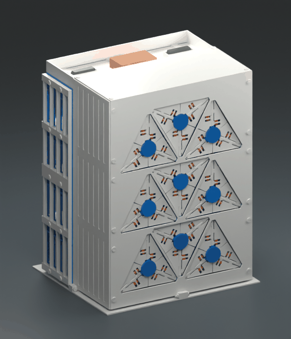
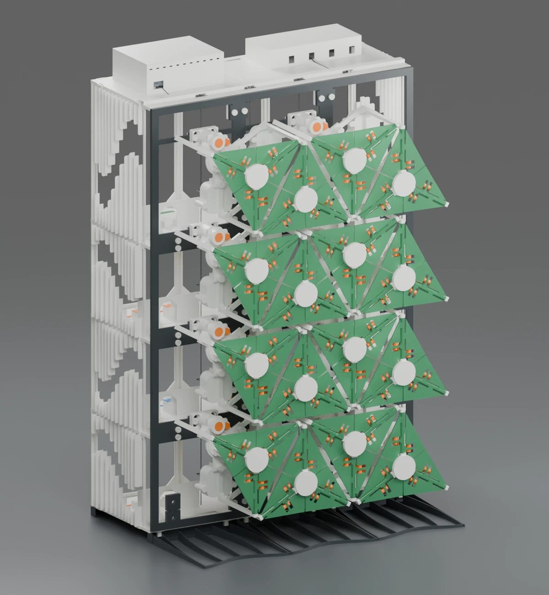
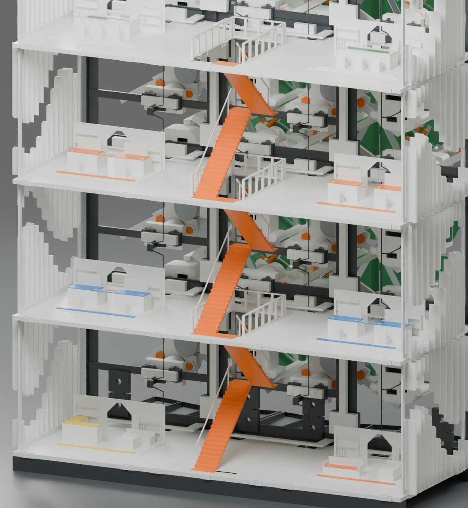
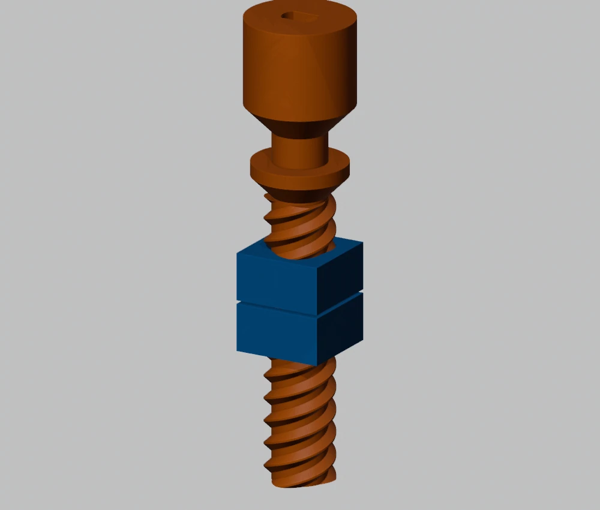
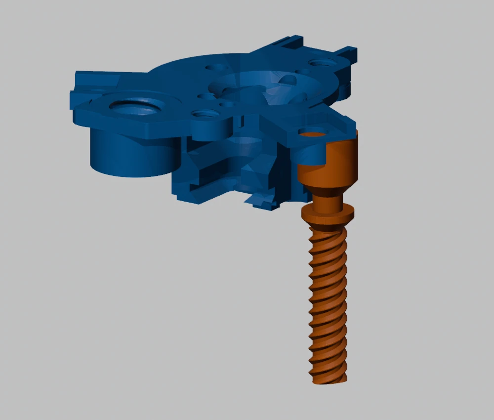

# SolarSkin - a 3D printed kinetic facade controlled by an ESP32

Turn the orange screw behind one window and six leaves fold open together.
SolarSkin repeats that mechanism across the front of a model office building.
The Blender assembly lets you look through the facade, around the back and
between the floors.

[Open the complete building in Blender](cad/04_building_optional/BUILDING_ASSEMBLY.blend)
or [download the build files and both illustrated manuals](https://github.com/vluncasu/SolarSkin/releases).

## Explore the building

| Facade closed | Floors and interior |
|---|---|
|  |  |

The building has nine module positions. The exhibition stand is a separate
sixteen-position frame. Its open back gives access to the motor plugs,
receiver screws and wiring. The installed controller drives fourteen motors.

[Tour the building](docs/12_building_and_facade.md) ·
[Follow the assembly in 21 pictures](docs/14_photo_walkthrough.md)

## Print one working module

| Filament | Pieces | What to look for |
|---|---:|---|
| Windows blue | 30 | Hub, guides, carriage, split nuts, axles and mounting parts |
| White | 6 | Three left leaves and three right leaves |
| Orange | 26 | Lead screw, links, joint nuts and connectors |

Start with the orange P13 screw and the blue P12 and P26 nuts.
Thread each nut onto the screw by hand. One turn advances it 10 mm.
This small print checks the fit of the most sensitive interface
before you commit to printing nine sets.

[Four prearranged 3MF plates](print/09_one_module_plates/) ·
[One-module bed layouts](docs/13_print_beds.md) ·
[Dimensions of every printable STL](docs/15_print_dimensions.md) ·
[Color folders and quantities](docs/03_printing_and_bom.md) ·
[Illustrated parts catalogue](docs/pdf/SOLARSKIN_PARTS_CATALOG.pdf)

## Assemble the mechanism

| Screw and split nuts | Screw entering the frame |
|---|---|
|  |  |

The carriage slides along three guides. Push the screw through the side
opening in the rear frame before fitting the motor. Each printed axle carries
a left and a right leaf. A short rod connects each leaf to the carriage.
Turn the assembled screw by hand and watch all six joints through a full cycle.

[Module assembly, in order](docs/04_mechanism_assembly.md) ·
[Frame, feet and receiver mounting](docs/05_frame_assembly.md) ·
[Engineering and assembly PDF](docs/pdf/SOLARSKIN_ENGINEERING_AND_ASSEMBLY.pdf)

## Calculate how far the motor must turn

Three helices share the screw. Adjacent crests are 3.333 mm apart along its
axis. Follow the same helix for a complete turn and it climbs 10 mm.
The 12 mm pivot arm and 20 mm rod need 15.348 mm of carriage travel
to move a leaf from 0 to 75 degrees in CAD.

That takes 15.348 / 10 = 1.535 screw turns. At direct drive, the motor's
nominal 4,096 half-steps per geared output turn give about 6,287 half-steps.
With an additional reduction, multiply by the measured number of motor
output turns per screw turn.

[Thread profile, helix equations and clearance](docs/02_screw_and_motor_calculations.md) ·
[Linkage derivation](docs/01_mechanism_and_kinematics.md) ·
[Reproduce the calculations](engineering/calculations.py)

## Wire and run the controller

One ESP32 sends 56 bits through seven 74HC595 registers.
Each register feeds two ULN2003 drivers. Each driver operates one
12 V motor. The baseline firmware cycles through opening and closing
as soon as its startup delay ends. A phone connected to the SolarSkin
Wi-Fi network can stop, resume or reverse the motion.

The exhibition program uses 25,148 full steps per direction.
Measure the extra reduction before using that setting. With direct coupling,
it would command about 122.8 mm against a CAD stroke of only 15.35 mm.
The controller counts commands and has no end-position sensor.

[Pin-by-pin wiring](docs/06_electronics.md) ·
[Set the travel, upload firmware and open the controls](docs/07_firmware.md) ·
[What was tested](docs/09_verification.md) · [Engineering references](docs/11_references.md)

Maintained by [vluncasu](https://github.com/vluncasu).
[License status](LICENSE_STATUS.md).
