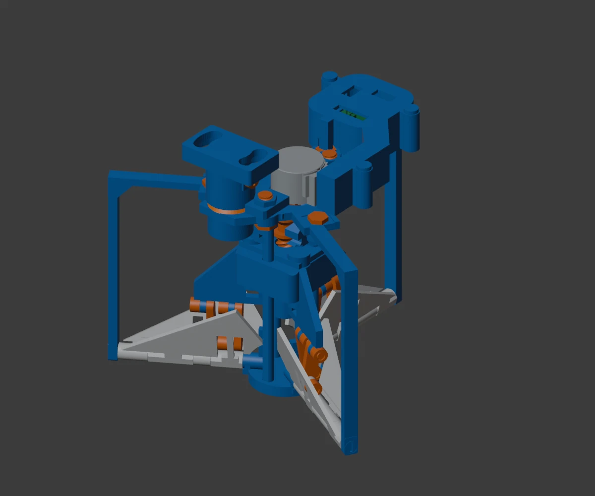

# Mechanism and kinematics

## Mechanical chain


The screw rotates while the carriage is constrained against rotation by the guide system. The carriage moves all six connecting rods. Each mirrored wing pair shares a radial axle P08; the three sectors repeat at 120 degrees around the hub.



## Geometry taken from the source

The source `kernel.py` defines a wing attachment radius **r = 12 mm**, connecting rod length **l = 20 mm**, and wing angle **theta = 0...75 degrees**. In each wing plane, the rod connects `(r*cos(theta), r*sin(theta))` to `(0, z)`.

The rod-length constraint is

$$[r\cos\theta]^2+[z-r\sin\theta]^2=l^2.$$

Taking the assembly branch used by the CAD:

$$z(\theta)=r\sin\theta+\sqrt{l^2-r^2\cos^2\theta}.$$

At the endpoints:

- `z(0 deg) = 16.000000 mm`.
- `z(75 deg) = 31.348483958 mm`.
- **Stroke = 15.348483958 mm**.

The saved CAD report uses zero at the open end, so its displacement is `z(theta) - z(75 deg)`. This document measures travel from the closed end, `x = z(theta) - z(0 deg)`. They describe the same motion with different origins.

[Source CAD samples](../engineering/evidence/cad_stroke_samples.json) · [Original helper](../engineering/evidence/original_kinematic_helpers.py) · [Computed samples](../engineering/results/kinematic_samples.csv)

## Motion is nonlinear

The carriage does not advance by an equal distance for every degree of wing rotation:

$$\frac{dz}{d\theta}=r\cos\theta+\frac{r^2\sin\theta\cos\theta}{\sqrt{l^2-r^2\cos^2\theta}}.$$

Here theta is in radians when using the derivative. The denominator stays positive for this geometry; the selected branch is continuous through the modeled range.

For six equal wing loads, neglecting friction and other loads, virtual work gives

$$F_c\,dz=6\tau_w\,d\theta,\qquad \tau_w=\frac{F_c}{6}\frac{dz}{d\theta}.$$

Convert mm/radian to m/radian before multiplying force in newtons to obtain torque in N m. Unequal wing loads, joint friction, backlash and printed compliance require a physical test; they are not included in this relation.

## Reproduce the calculation

```sh
python3 engineering/calculations.py --export
python3 engineering/test_calculations.py
```

The tests reproduce all nine source CAD sample positions and their screw angles, check the 20 mm link constraint, compare the analytic derivative with finite differences, and check step-count and force units.
