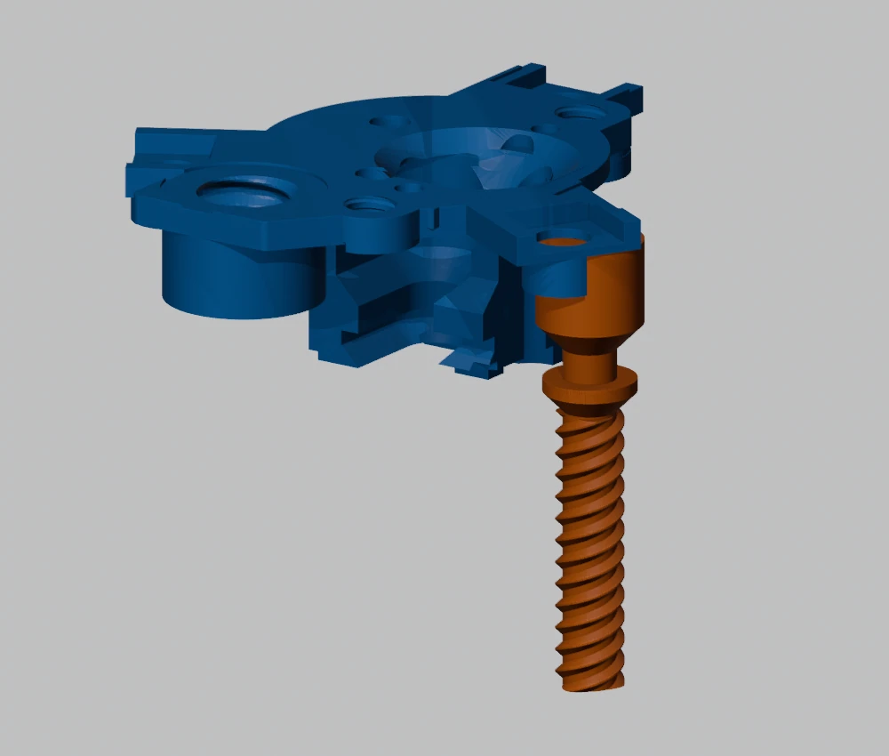
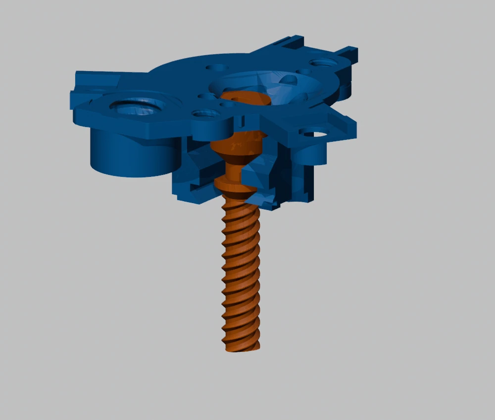

# Mechanism assembly

Use the current 10 mm P13/P12/P26 family together. The illustrated manual and parts catalogue show the actual geometry; this sequence replaces mixed historical instructions for the earlier common frame.

## 1. Guides and carriage

Parts: **P04 x1, P09 x3, P10 x1**.

Align each D-profile guide with the matching hub socket. Fit the three guides to the front hub. Slide the carriage over the guides and verify free movement. The guides remain fixed; the carriage must not be forced to rotate.

## 2. Split nuts and cover

Parts: **P12 x1, P26 x1, P11 x1, P29 x2**.

Test each nut on the 10 mm-lead screw by hand. Place the lower and upper nuts in their CAD pockets; they are a matched pair. Close the carriage with P11 and tighten the two P29 screws alternately. Do not clamp the split nuts axially into each other or use tightening to remove a geometric misalignment.

## 3. Insert the screw into the rear frame

Parts: **P02 x1, P13 x1**. Keep the motor, clamps and frame connector off P02 during insertion.

1. Keep P13 parallel to its final axis. Enter through the lateral frame opening opposite the large connector.
2. Slide toward the bearing without changing the shoulder height.
3. Move inward until the coupling shoulder seats in the bearing.
4. Lower the P02/P13 subassembly onto the three guides and turn the screw manually into the nuts. Do not twist the carriage to force engagement.

## 4. Pillars and driver tray

Parts: **P05 x3**, short pairs **P33/P34 x2**, long tray pair **P36/P37 x1**, **E01 x1**.

Install the three pillars. At the tray sector, insert P37 from above through the access opening, with the longer P36 bushing from below. Use the printed access tool. The other two sectors use the short bushing/cone pairs. Complete this fastening before installing the driver board and lid.

## 5. Wings and radial axles

Parts: **P07L x3, P07R x3, P08 x3**.

Align one left/right wing pair with each pillar and hub. Insert the axle from the outside through the pillar and wings, then engage its terminal thread in the hub. Seat the round/slotted head in the pillar recess without over-tightening. Each original axle is identical. The terminal thread is nominal diameter 4 mm, pitch 1.2 mm and length 6 mm; the wing-bearing shaft is nominal diameter 5.13 mm.

## 6. Link rods

Parts: **P16 x6, P32 x12**.

Install one orange rod per wing. Each rod has two joints and two nuts. Check articulation after tightening: the joint must rotate, not clamp solid. Six rods correspond to the six leaves, not three rods per entire module.

## 7. Motor clamp stack

Purchased motor plus **P30 x2, P03 x2, P31 x2**.

Use the established stack: motor screw, clamp, then locknut. The clamp pin enters the motor mounting ear; the clamp supplies seating pressure. Confirm alignment of the motor shaft and P13 socket before tightening. Check screw rotation by hand before electrical operation.

## 8. Driver and cable

Purchased driver board plus **E02 x1, E03 x3**.

Route the cable and place the board before closing the lid. Keep the cable in its channel, away from fasteners and moving rods. Fit the cover and three printed cover screws. E03 is not interchangeable with the shorter P46 receiver screw.

## 9. Frame connector and receiver

Parts: **P44 x1, P45 x1, P46 x1**.

Thread P44 into P02 until its shoulder seats. Its nominal large paired thread is diameter 16 mm, pitch 4 mm with 16 mm engagement. Slide P45 over the D-profile shank and fit P46 transversely. These are custom printed interfaces; they are not an invitation to substitute ISO metal hardware.

The current stand uses **F01/F02** to attach P45 to its cassette. Do not copy the older 20-module rail system's D8 mounting instructions into this frame.

## 10. First test

With power off, traverse the mechanism manually and confirm both endpoints, all six rods and the cable loop. Then use the calibrated motor count for the actual reduction. Check the first printed module before populating the frame. The open-loop firmware does not detect a hard stop or missed steps.
