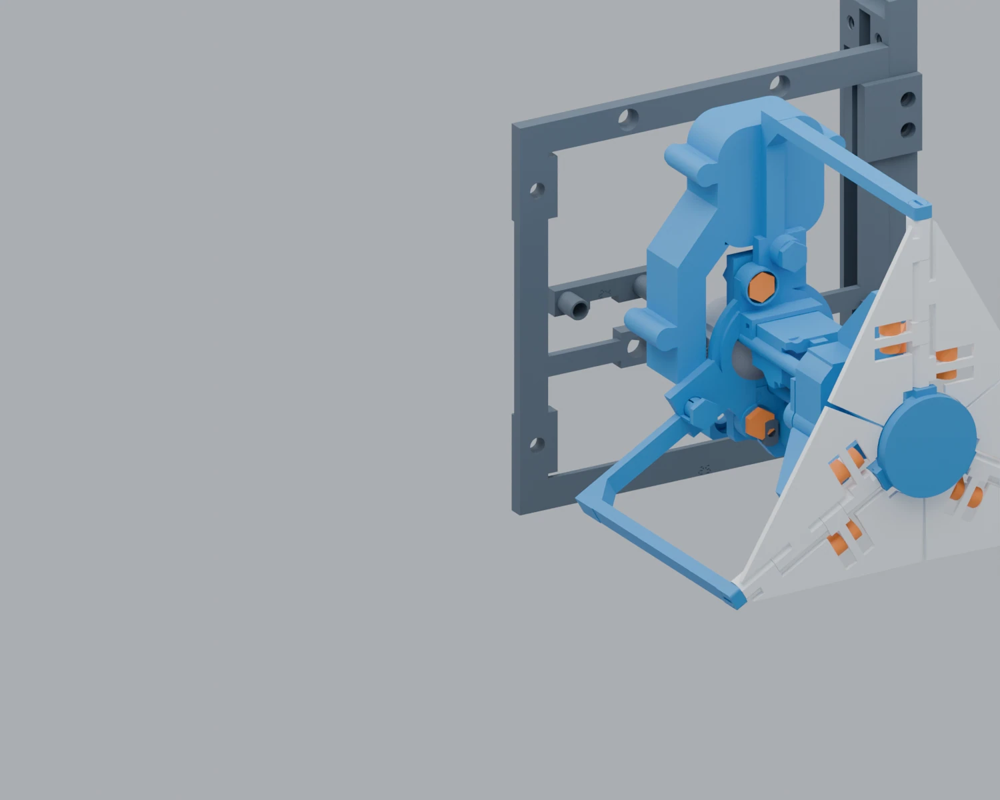

# Frame, reinforcement and feet

## Models and view index

Open [the complete reinforced model](../cad/03_reinforced_assembly/REINFORCED_16_MODULE_ASSEMBLY.blend). Its numbered scenes show:

| Scene | View |
|---|---|
| 01 / 02 | All modules closed / open |
| 03 | Reinforced frame without mechanisms |
| 04 / 05 | Module M13 mounted / exploded |
| 06 | Receiver and mounting fasteners |
| 07 | Single mechanism |
| 08 / 09 | Rear foot / four feet exploded |
| 10 | Lower right reinforcement connection |

Exploded offsets illustrate assembly order, not a validated insertion trajectory. `Home` frames the view; middle mouse rotates; `H` hides selected objects and `Alt+H` restores them.


## Base frame

The rear structural cassette map is:

```text
28 32 36
27 31 35
26 30 34
25 29 33
64 64 69  <- original base pieces
```

Front-view left/right is reversed relative to this rear view. The twelve cassettes are structural components; the receiver layout has sixteen nominal mechanism positions.

Assemble the cassettes on a flat surface, fit the matching rear splices and tighten alternating fasteners by hand. Consult [frame.csv](../bom/frame.csv) for each engraved ID and quantity. The twelve captive cross-members F10 are for the optional building connection; they are not additional mechanisms.

## Side ribs and front clamps

1. Fit **four R01 right ribs** and **four R02 left ribs**. Keep the original handedness; mirroring a threaded part is not equivalent.
2. Join the segments with **six R04 side splices and 24 R21 screws**.
3. Add **16 R03 front clamps and 32 R05 screws**, two clamps per rib segment.
4. Reserve **two more R05 and two more R21** for the rear-foot adapter.

Totals are **34 R05, overall length 15 mm**, and **26 R21, overall length 18.8 mm**. The nominal segment joint is 0.4 mm; the longer splice screw's end remains nominally recessed by 0.2 mm in the checked stack.

## Base supports

Use **two R22, two R23, four R24 and eight R25**. R23 is required at both the original right foot and the additional rear foot: **two copies**, not one.

- R22 supports the two original F13/codemark 64 feet.
- R23 supports the original F18/codemark 69 at the right and a second F18 at the rear.
- Each foot receives one R24 retaining saddle and two R25 screws, overall length 61 mm.
- All four supported feet are nominally raised by 18 mm. Seat all of them on the table before final tightening.


## Additional rear foot

Rotate the extra F18 in plan so its sole extends backward; do not turn it upside down. Place R31 against the flat upright face. Use two R05 through its access openings into the foot's existing threaded locations, nominally 34 and 60 mm above the original base. Attach the adapter to the lower R01 through the remaining holes with two R21. Engage all four screws before alternating final tightening.

Do not use the rear foot as a carrying handle. It must increase the support polygon without lifting an existing sole off the table.

## Mount each mechanism

For **one mechanism**: **2 F01 receiver bolts, 1 F02 double nut bar, and the long key F17 / engraved 68**.



1. Work from the bottom upward, alternating left and right, with motor power off.
2. Support the mechanism by the receiver/body, not its wings.
3. Put F02 behind the cassette, with its bushings pointing toward P45. Initially leave about 6 mm of rear access.
4. Insert both F01 from the front beside the P45 tube. Align their flattened heads with the clearance recesses.
5. Bring the F02 bushings through the cassette and into the receiver. Keep wires out of the mating stack.
6. Start both threads before tightening either one fully. Tighten alternately by hand with the long key.

F01's nominal overall length is 18.4 mm; head 5.6 x 10.4 x 2.4 mm; hex recess 3.2 mm; custom thread diameter 5.8 mm and pitch 1.5 mm. **It is not an ISO M6 replacement.** Do not use R05/R21 here.

For 16 mechanisms: 32 F01 + 16 F02. For 12: 24 F01 + 12 F02. Front-view positions are 01-04 at the top, then 05-08, 09-12 and 13-16. Columns 2 and 4 use 180-degree-rotated modules as modeled; do not mirror them.

## Cable guides

Four R41 clips are optional. Trial one clip on the available rear R01/R02 edge before printing all four. Leave motion loops and strain relief; a clip guide is not cable strain relief or an electrical connector. R41 supersedes the large R40 organizer in the current recommendation.

## Why reinforcement helps

For a simplified beam, bending stiffness is `E*I`; a rectangular section has `I=b*h^3/12`, and ideal cantilever tip deflection is `delta=F*L^3/(3*E*I)`. Rib depth can therefore improve local stiffness efficiently. These relations are not a finite-element validation of the entire printed assembly.

A horizontal force at height H creates an overturning moment `F*H`; gravity supplies a restoring moment through the actual centre of mass and contact polygon. The added rear foot increases fore-aft support extent. Material stiffness, print direction, screw fit, centre of mass and physical loading remain unmeasured.
