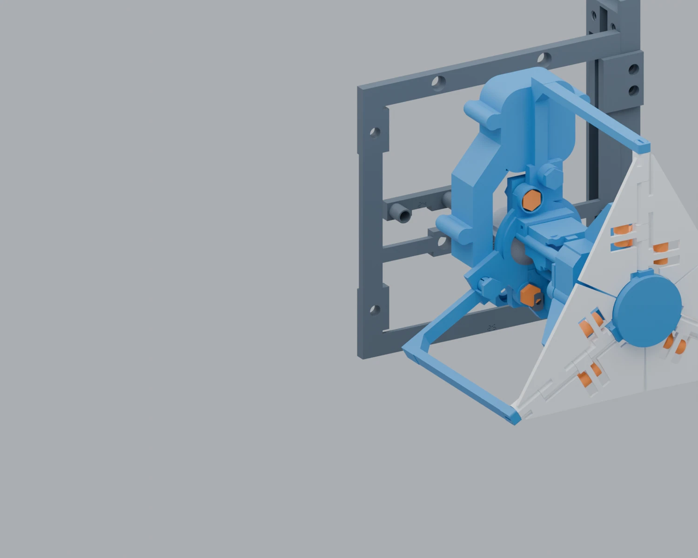
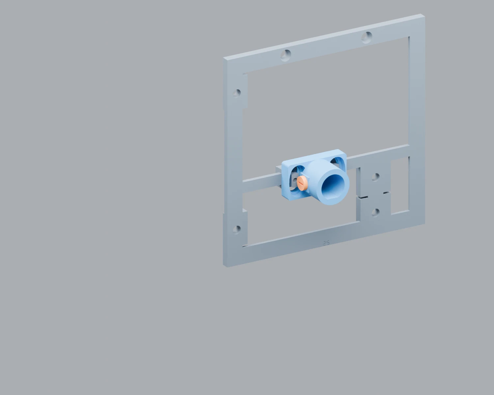
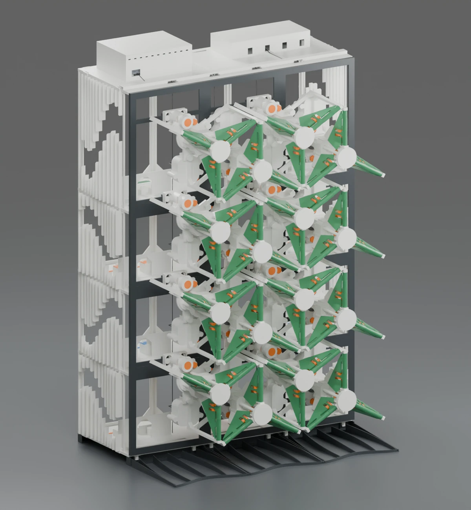
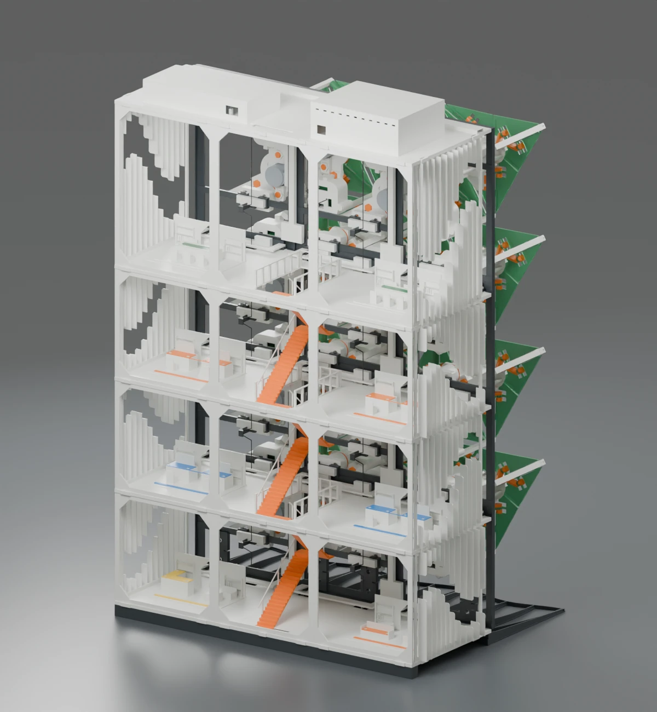
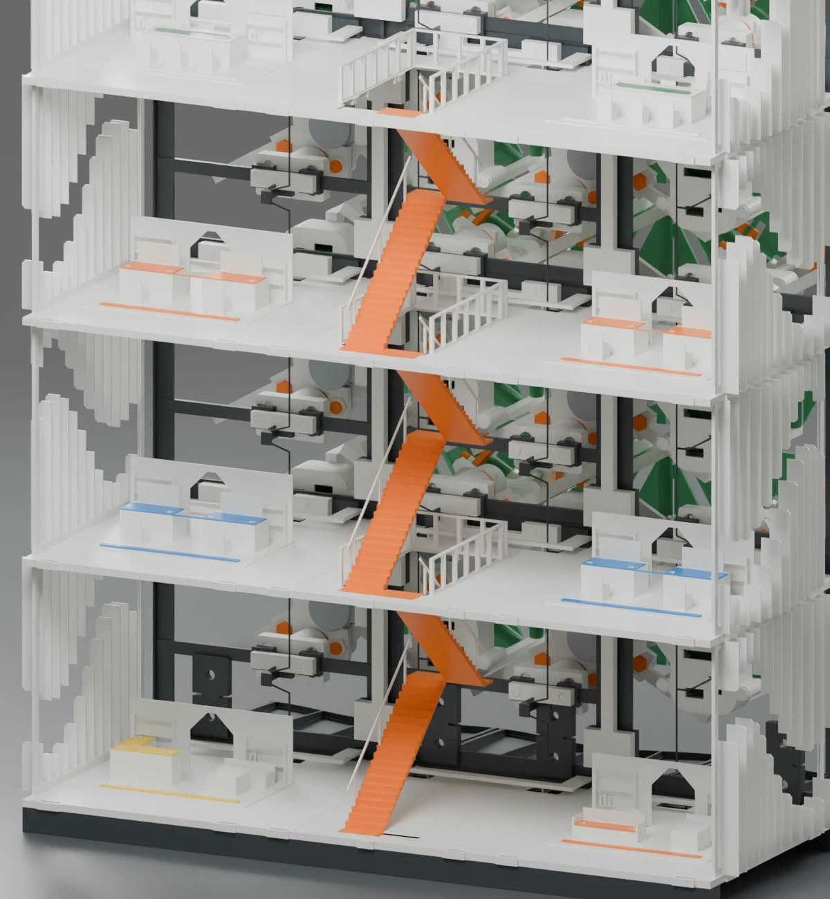

# CAD and renders

[Compare the furnished building, simplified building and standalone frame](12_building_and_facade.md).

| File | Purpose |
|---|---|
| [MECHANISM_10MM.blend](../cad/01_mechanism/MECHANISM_10MM.blend) | Original animated mechanism; legacy object IDs preserve its animation references |
| [MECHANISM_10MM.FCStd](../cad/01_mechanism/MECHANISM_10MM.FCStd) | Editable full mechanism |
| [LEAD_SCREW_10MM.FCStd](../cad/01_mechanism/LEAD_SCREW_10MM.FCStd) | Compact screw and split-nut model |
| [FRAME_ONLY.blend](../cad/02_frame/FRAME_ONLY.blend) | Original frame without mechanisms |
| [REINFORCED_16_MODULE_ASSEMBLY.blend](../cad/03_reinforced_assembly/REINFORCED_16_MODULE_ASSEMBLY.blend) | Current static assembly and English scene index |
| [BUILDING_ASSEMBLY.blend](../cad/04_building_optional/BUILDING_ASSEMBLY.blend) | Later sixteen-position threaded-mount architectural revision |

STEP exports are provided alongside editable CAD. Part IDs, geometry and orientation are authoritative; render materials are not a manufacturing specification. Some older animated files retain legacy identifiers to avoid breaking drivers or constraints.

## Current assembly views

## Existing architectural renders

The architectural images predate some reinforcement revisions. They are concept/CAD images, not photographs or proof of structural validation.

## Rebuilding the thread

Run `engineering/source/rebuild_thread.FCMacro` in a compatible FreeCAD environment. It uses the supplied interface reference BREP and writes into `engineering/generated_thread/`. This preserves the earlier journal/coupling interface while regenerating the three-start thread and matched nuts. The source describes the construction; a new build still needs geometric verification against the evidence and fit testing.
