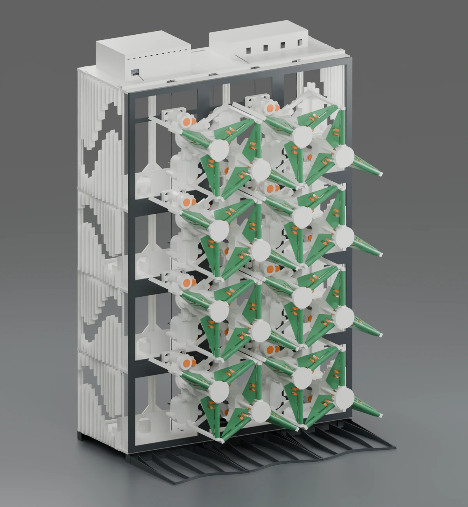
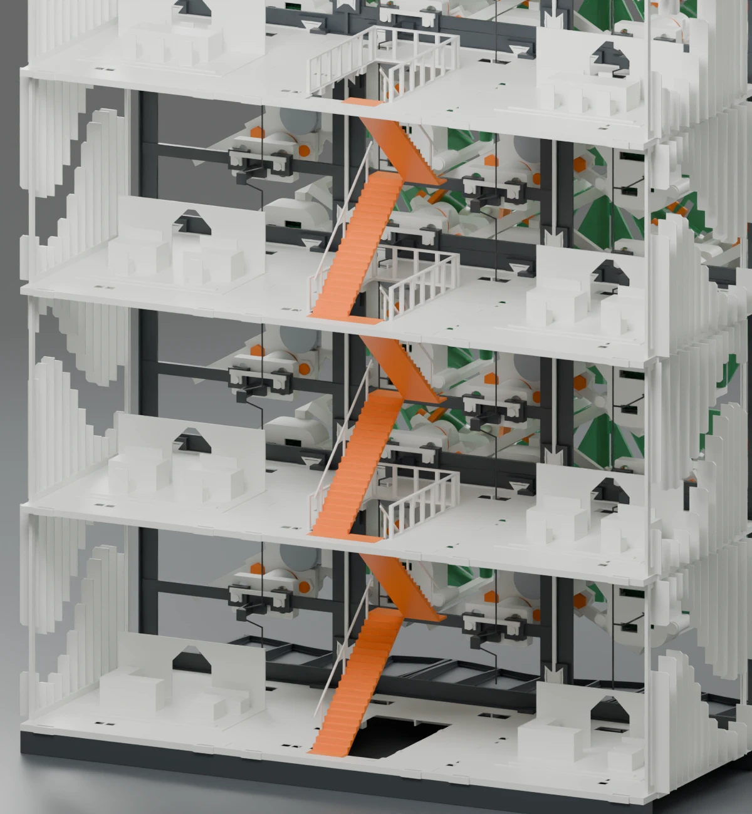
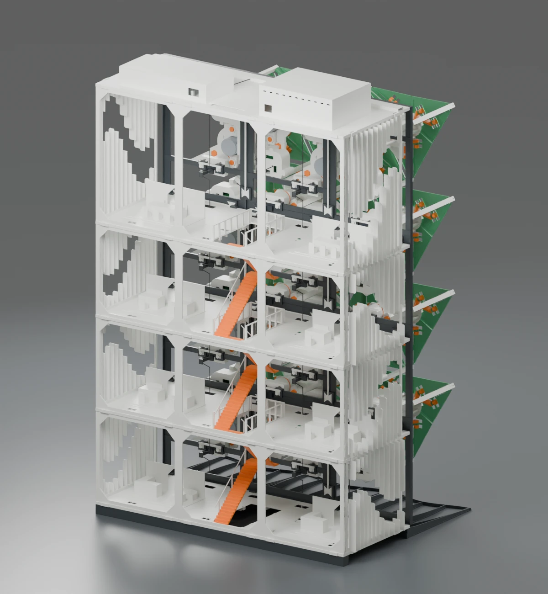
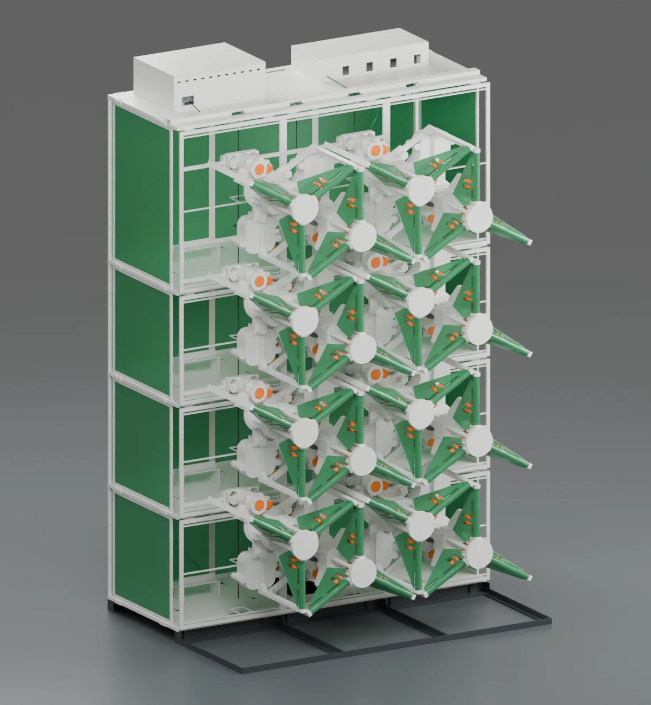
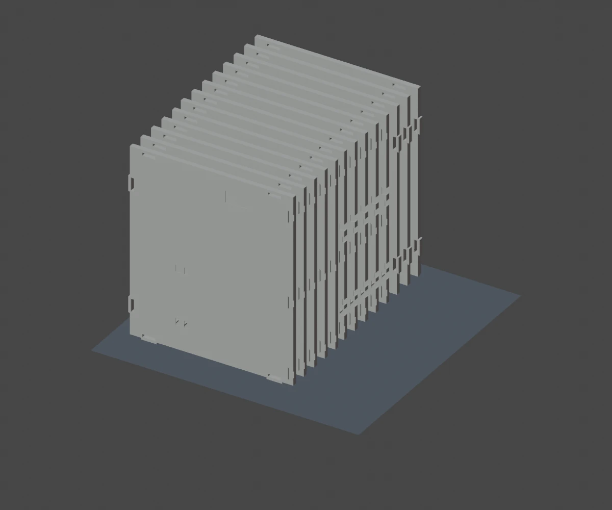

# SolarSkin: comparative design of three kinetic facade prototypes

## Abstract

A facade module can be demonstrated in isolation, but an architectural model
must also accommodate floors, circulation, wiring and access for assembly.
This study compares three physical layouts for the same six-leaf mechanism.
The furnished office examines the relationship between the moving envelope
and occupied space. The simplified office retains a building around the facade
while reducing the printed interior. The independent stand exposes the
receivers and drives for a working demonstration.

## Research question and method

What can be removed from the building while preserving the geometry needed
to display and operate its facade? The comparison holds the nominal facade
capacity at sixteen positions. It examines three different bodies of evidence:
the Blender scenes for spatial arrangement, the manufacturing inventories
for material and quantities, and the kinematic model for commanded travel.
A Blender object may represent an instance, camera or light. Printed part
counts below come from the inventories.

| Configuration | Editable assembly | Fabrication evidence |
|---|---|---|
| Furnished office | [Building and detachable facade scene](../cad/furnished/OFFICE_16.blend) | [193 architectural pieces across 46 beds](../print/furnished/) |
| Simplified office | [Building assembly](../cad/simplified/OFFICE_16.blend) | [158 architectural pieces across 63 beds](../print/simplified/) |
| Independent stand | [Reinforced frame with mechanisms](../cad/03_reinforced_assembly/REINFORCED_16_MODULE_ASSEMBLY.blend) | [Frame inventory](../bom/frame.csv) and [reinforcement inventory](../bom/reinforcement.csv) |

The two architectural counts assume that the moving modules already exist.
For sixteen new mechanisms the current module inventory adds 16 × 62 = 992
printed pieces. Check the receiver interface of the selected revision before
committing to the complete batch.

## I. Furnished office: envelope, circulation and assembly access

Sixteen mechanisms give the elevation 96 moving leaves. Behind them, eight
removable interior units represent two reception areas, four workshops and
two meeting areas. A central stair connects the floors. Each unit sits on its
floor and is located by a two-pin bar inserted from above. This detail sets
the assembly sequence: install the interior and its bar while the upper floor
is still accessible.

Eight side panels combine the fins with their surrounding frames. Fin
projection varies from 8 to 14 mm. Combining the fins in each panel fixes
their spacing during installation. Open rear frames preserve views into the
rooms. Local ribs and 16 mm corner gussets provide stiffness where the
earlier cross-bracing occupied the openings. The source specifies 0.8 mm
furniture walls with internal ribs spaced at most 10 mm apart. These are
nominal design dimensions. The publication contains no measured lateral
stiffness for the completed building.

## II. Simplified office: consequences of a shorter inventory

The rapid manufacturing lot omits the optional furniture. It retains the
floor system, stair, facade and thin translucent glazing. The two office
variants differ in their envelopes as well: the furnished design leaves the
interior open to view, while the rapid lot includes green PETG glazing laid
flat at a nominal one-layer thickness of 0.20 mm.

The slabs stand on edge, approximately 180 mm high. The rapid plan specifies
a 5 mm outer brim. Two sacrificial 0.4 mm ribs interrupt the stair opening
during printing and are removed afterwards. The remaining bridges reach
approximately 38 mm. Inspect a representative bridge with the intended
filament before printing the repeated slabs.

Compared with the furnished lot, this design uses 35 fewer new pieces yet
occupies 17 more planned beds. Piece count alone therefore cannot predict
bed changes or machine time. The source estimates 29.9 hours for the rapid
lot and 30.5 hours for the furnished lot at an assumed effective PLA flow of
16 cubic millimetres per second. These are model estimates. No timed
comparative print establishes a six-tenths-of-an-hour advantage.

## III. Independent stand: stability and maintenance

Removing the floors and rear building structure changes how horizontal
forces reach the base. A horizontal force F at height h produces a moment
Fh at the feet. The ribs connect adjacent frame segments, the base supports
reinforce the printed soles, and the rear foot extends the support footprint.
An overturning-load calculation would also need the assembled mass, centre
of gravity and contact locations. Those measurements remain open.

The numbered Blender scenes isolate the empty reinforced frame, the mounted
receiver, its exploded connection and the rear foot. Use scene 03 to
assemble the frame before installing a motor. Scenes 04 to 06 show the
current two F01 screws and F02 locking plate at one occupied position.
[Frame assembly and mounting order](05_frame_assembly.md).

## IV. Relating architecture to actuation

The three layouts share a motion problem. A screw drives a carriage along
three guides. Six rods link the carriage to the leaves. For a pivot radius
of 12 mm and a rod length of 20 mm, the rigid linkage gives an axial
coordinate of 16.000 mm at closure and 31.348 mm at 75 degrees. The
difference, 15.348 mm, determines the required screw travel.

With three starts and axial pitch 10/3 mm, the screw lead is 10 mm per
revolution. The calculated stroke takes 1.5348 screw turns. Multiplying by
4,096 nominal half-steps per geared motor output turn gives approximately
6,287 half-steps for direct coupling. Any additional reduction multiplies
this count by the number of motor output turns per screw turn.
[Derivation and CAD comparison](01_mechanism_and_kinematics.md) ·
[Helix construction and reduction equations](02_screw_and_motor_calculations.md).

Seven cascaded registers provide 56 outputs. Four coil commands per motor
give fourteen independent electrical channels. Consequently the current
hardware can address fourteen of the sixteen mechanical positions.
The published baseline sends the same phase sequence to those channels.
A render of sixteen open modules records a geometric pose. Actual actuator
travel must be observed because the controller has no position feedback.
[Wiring](06_electronics.md) · [Software and calibration](07_firmware.md).

## Reproduction and scope of validation

Select one architectural lot. Each directory contains its own 3MF beds,
inventory and placement list. Original CAD part identifiers are retained so
that a row can be matched to the object in Blender. The 3MF files contain
geometry. Configure the printer, filament, brim and process before slicing.
For the stand, use the separate frame and reinforcement inventories.
[Four color-separated beds for one mechanism](13_print_beds.md).

The furnished scene and its rapid lot derive from
`SOLARSKIN_16_INTERIOR_COMPLET`. The simplified scene and rapid lot derive
from `SOLARSKIN_16_V5_RAPID`. The stand derives from the reinforced
16-position mounting assembly. Each office illustration above was taken from
the PLANSE directory of the corresponding revision. The earlier nine-module
animation in the visual archive documents a separate concept.

The counts are reproducible from the two inventories and supplied bed files.
The equations can be checked against the saved CAD positions. Neither
procedure measures friction, fatigue, electrical reliability or resistance
to tipping. A comparative experimental study would record print duration,
filament mass, loaded frame deflection and achieved leaf angle for each
configuration under the same test conditions.
