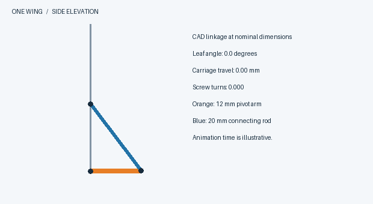

# Motion, interference and assembly checks

The animation advances the carriage in equal increments. For each increment the program solves for the angle at which the 20 mm rod closes the linkage. The 12 mm attachment radius fixes the moving end of that rod. The changing angle per frame shows why equal screw turns do not produce equal leaf-angle changes. [Run the simulation](../engineering/simulate_cycle.py).

## Comparison against the CAD poses

Travel below is measured from closure. The saved CAD report measures its offset from the open end. Adding the full stroke converts between the two origins. Screw turns and nominal direct-drive half-steps are cumulative from closure.

| Leaf angle | Analytic travel (mm) | CAD travel (mm) | Screw turns | Half-steps |
|---:|---:|---:|---:|---:|
| 0.000° | 0.00000 | 0.00000 | 0.00000 | 0 |
| 9.375° | 2.07371 | 2.07371 | 0.20737 | 849 |
| 18.750° | 4.31566 | 4.31566 | 0.43157 | 1768 |
| 28.125° | 6.62729 | 6.62729 | 0.66273 | 2715 |
| 37.500° | 8.89391 | 8.89391 | 0.88939 | 3643 |
| 46.875° | 10.99868 | 10.99868 | 1.09987 | 4505 |
| 56.250° | 12.83375 | 12.83375 | 1.28338 | 5257 |
| 65.625° | 14.30749 | 14.30749 | 1.43075 | 5860 |
| 75.000° | 15.34848 | 15.34848 | 1.53485 | 6287 |

At full travel the screw has turned 1.53485 times. The direct-drive count rounds to 6,287 half-steps. An extra 8:1 reduction requires about 50,294 half-steps. Measure the actual ratio on the installed mechanism before using the long demonstration command. [Thread construction, speed and force equations](02_screw_and_motor_calculations.md).

## What the interference reports cover

The furnished revision recorded 298 candidate comparisons and listed elastic detents separately. The unintentional-overlap list is empty for that check. A detent has a nominal overlap because it must deflect during insertion. Its required insertion force depends on the printed material. [Furnished CAD report](../engineering/assembly/furnished_interferente_revizie.json).

The simplified design records an intermediate check with collisions around the electronics, followed by a final electronics check of nine pairs with an empty overlap list. The second result applies to the corrected pairs. A continuous six-leaf sweep under load and the stability of a fully populated stand still need physical testing. [Intermediate check](../engineering/assembly/simplified_interferente_dupa_corectii.json) · [Final electronics check](../engineering/assembly/simplified_electronica_finala.json).

## Controller simulation

The stand simulation checks 56 clocks per latch, two energized coils per active full-step phase, reversal, manual override and timer wrap. Baseline and minimal simulations run four alternating legs of 6,287 steps. These tests observe the output bit patterns. They cannot detect a stalled shaft or a cable pulling on a moving leaf. [Recorded outputs from all three executables](../verification/workshop_simulation.txt).

## Physical commissioning record

Record the printed material, printer profile, mechanism ID and measured reduction before testing. Start with one module mounted at an accessible position. Advance to the adjacent pair before populating the frame.

| Check | Method | Record on this build |
|---|---|---|
| Thread and guide fit | Hand-turn within the free range. Measure axial displacement over one complete screw turn. Nominal value: 10 mm. | ____ mm |
| Wing sweep | With power off, observe all six joints and both neighbours throughout the intended range. Identify the first contact, if any. | ____ |
| Stroke calibration | Mark geared output and screw, measure additional reduction, calculate steps, then observe an opening and a closing cycle. | G = ____ / steps = ____ |
| Return error | Mark the physical start position and compare after repeated cycles. Record cycle count and displacement. | ____ cycles / ____ mm |
| Loaded stand | Confirm all soles contact the table. Measure top displacement at a recorded small horizontal load and height. | ____ N / ____ mm / ____ mm |
| Electrical operation | Count working motors under the intended load and record the supply voltage during motion. | ____ channels / ____ V |

The blank fields are for measurements on the actual build. No physical measurements were taken during preparation of this guide.
