# Architectural design archive

[Original twenty-module office building and kinetic facade](19_original_office.md).

The folder identifiers below match the original design records. Several mounting revisions retain the same exterior rendering. Use the CAD and print inventory of the selected revision to identify its hardware.

## Compact office, six modules

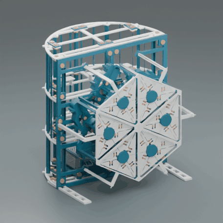

[Open the animated Blender scene](../cad/earlier_offices/COMPACT_OFFICE.blend).

Source assembly family: `SOLARSKIN_COMPACT_OFFICE_6`.

## Aurora pavilion

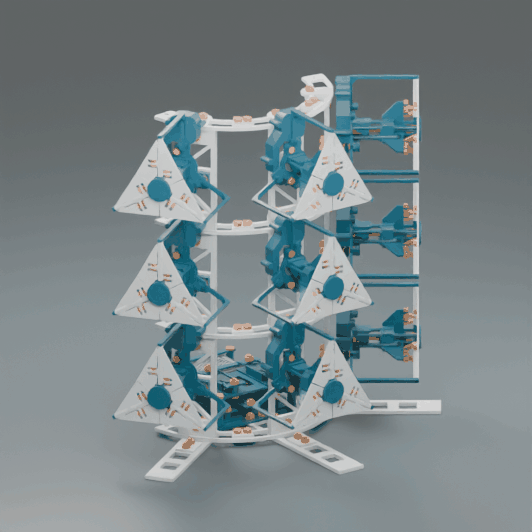

[Open the animated Blender scene](../cad/earlier_offices/AURORA_PAVILION.blend).

Source assembly family: `SOLARSKIN_AURORA_9`.

## Rigid office, eight modules

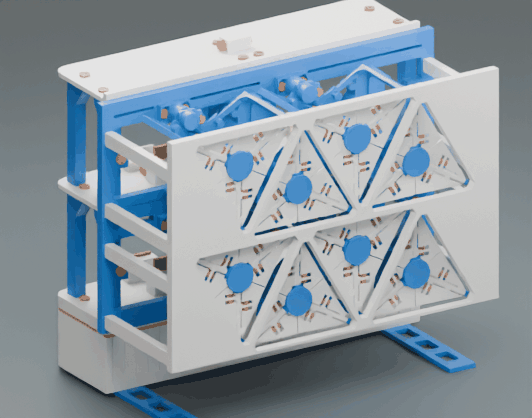

[Open the animated Blender scene](../cad/earlier_offices/RIGID_OFFICE.blend).

Source assembly family: `SOLARSKIN_OFFICE_RIGID_8`.

## Office, nine modules

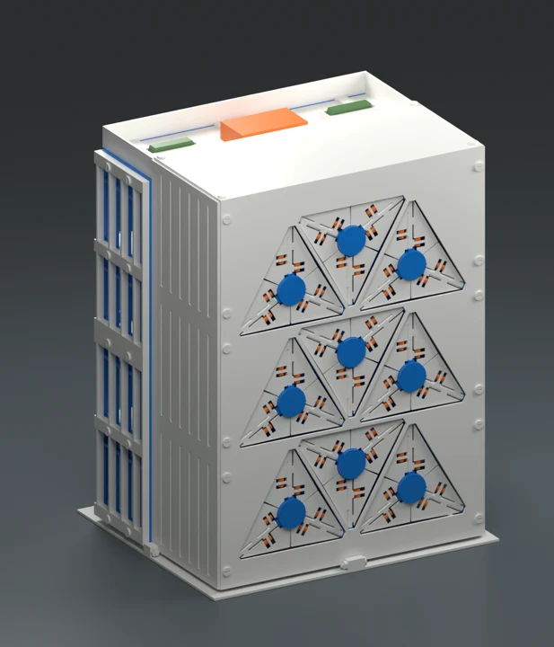

Source assembly family: `SOLARSKIN_OFFICE_9_ARCHITECT`.

## Integrated facade

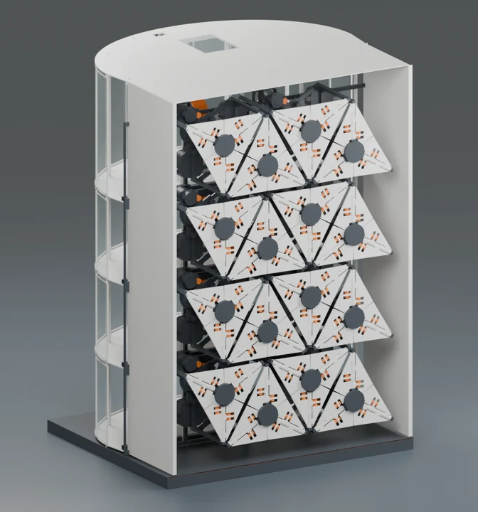

Source assembly family: `SOLARSKIN_16_INTEGRAT`.

## Rapid office

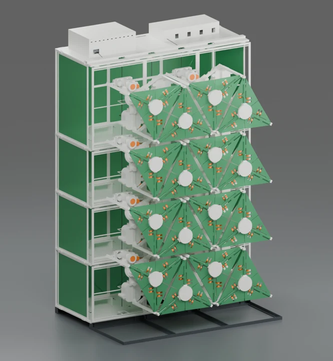

Source assembly family: `SOLARSKIN_16_V5_RAPID`.

## Unified facade

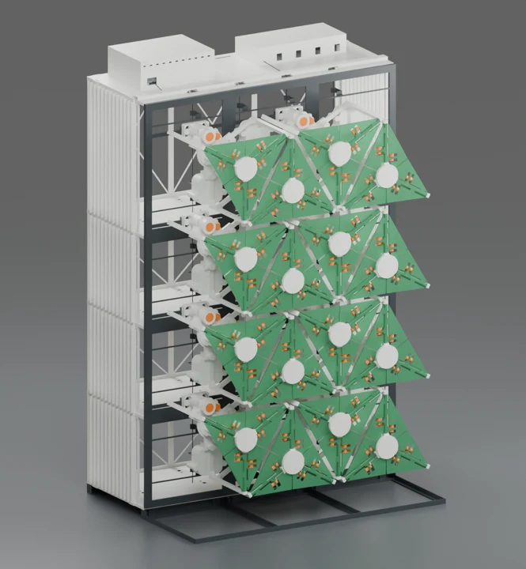

Source assembly family: `SOLARSKIN_16_FATADA_UNITARA`.

## Compact accents

Source assembly family: `SOLARSKIN_16_COMPACT_ACCENTE`.

## Sculptural envelope

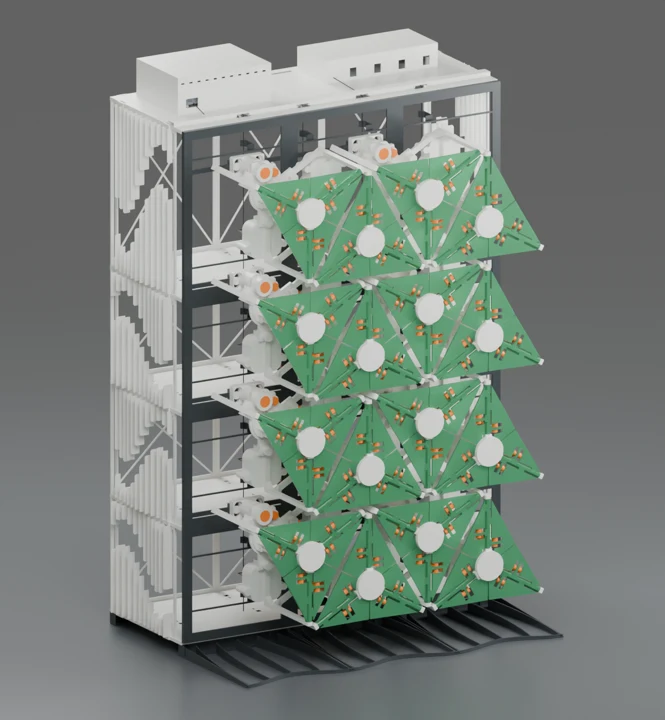

Source assembly family: `SOLARSKIN_16_SCULPTURAL`.

## Furnished office

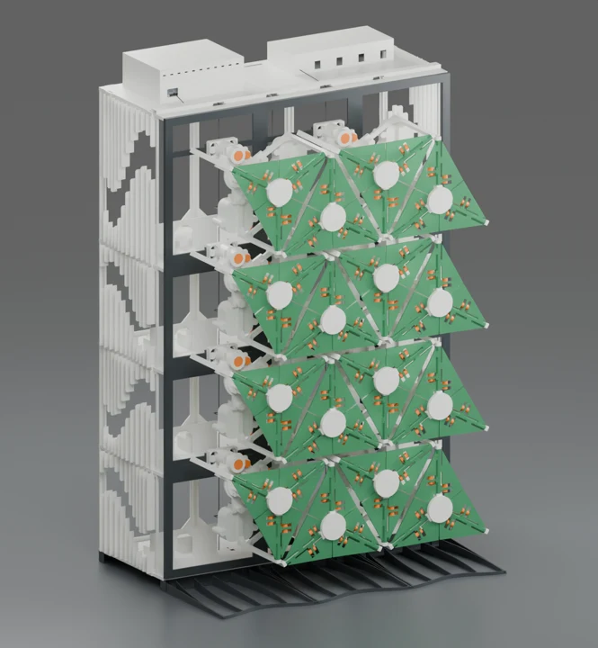

Source assembly family: `SOLARSKIN_16_INTERIOR_COMPLET`.

## Interior supports

Source assembly family: `SOLARSKIN_16_REAZEME_INTERIOR`.

## Connector revision

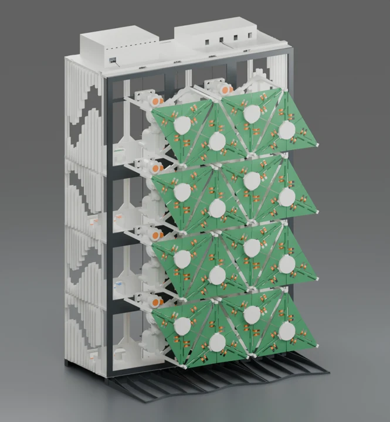

Source assembly family: `SOLARSKIN_16_CONECTORI`.

## Revised mounts

Source assembly family: `SOLARSKIN_16_PRINDERI_REVIZUITE`.

## Marked parts

Source assembly family: `SOLARSKIN_16_PIESE_MARCATE`.

## Engraved parts

Source assembly family: `SOLARSKIN_16_GRAVATE`.

## Threaded mounting revision

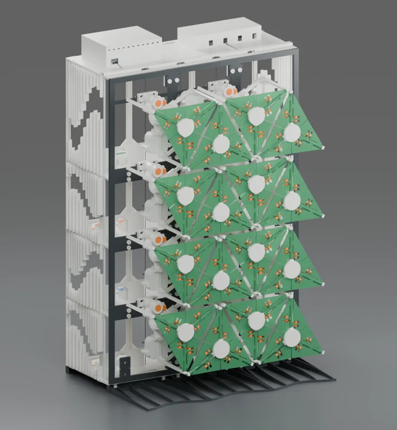

Source assembly family: `SOLARSKIN_16_FILET_PRIORITAR`.

## Motion in the downloadable scenes

The three preview assemblies preserve their building geometry and module
placement. The moving components use transforms sampled every six frames
from the original 10 mm mechanism. Each module has its own parent placement
in its building. Press Space in Blender to play the 241-frame sequence.

We reopened the delivered files and compared the world transforms of each
leaf at frames 1 and 121. All 36 leaves in Compact, 54 in Aurora and 48 in
Rigid change pose. The earlier twenty-module building retains its original
animation; all 120 of its leaves change pose between the same sampled frames.
[Read the verification record](../verification/original_offices_motion.json).
