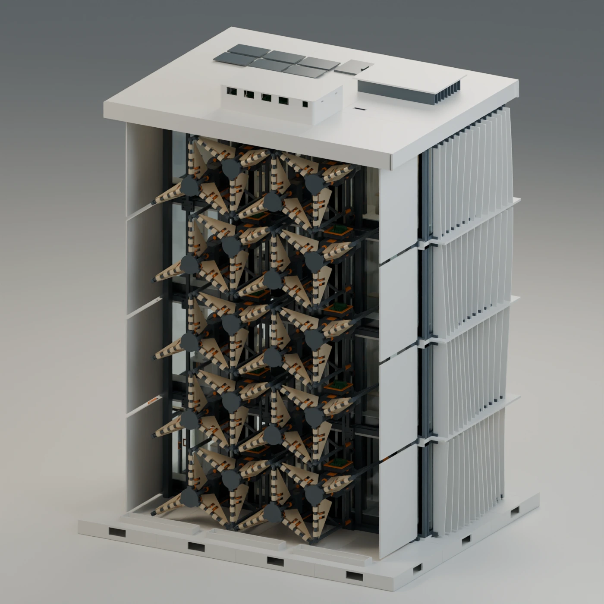
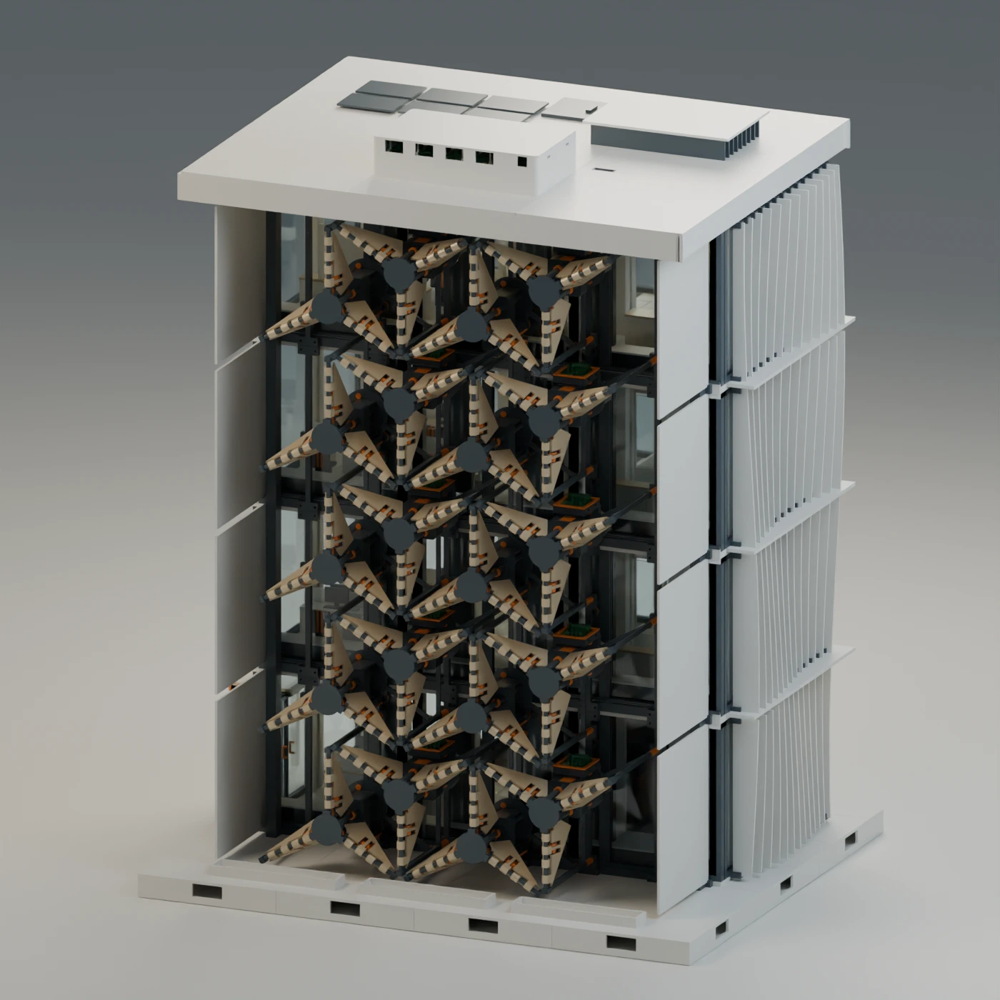
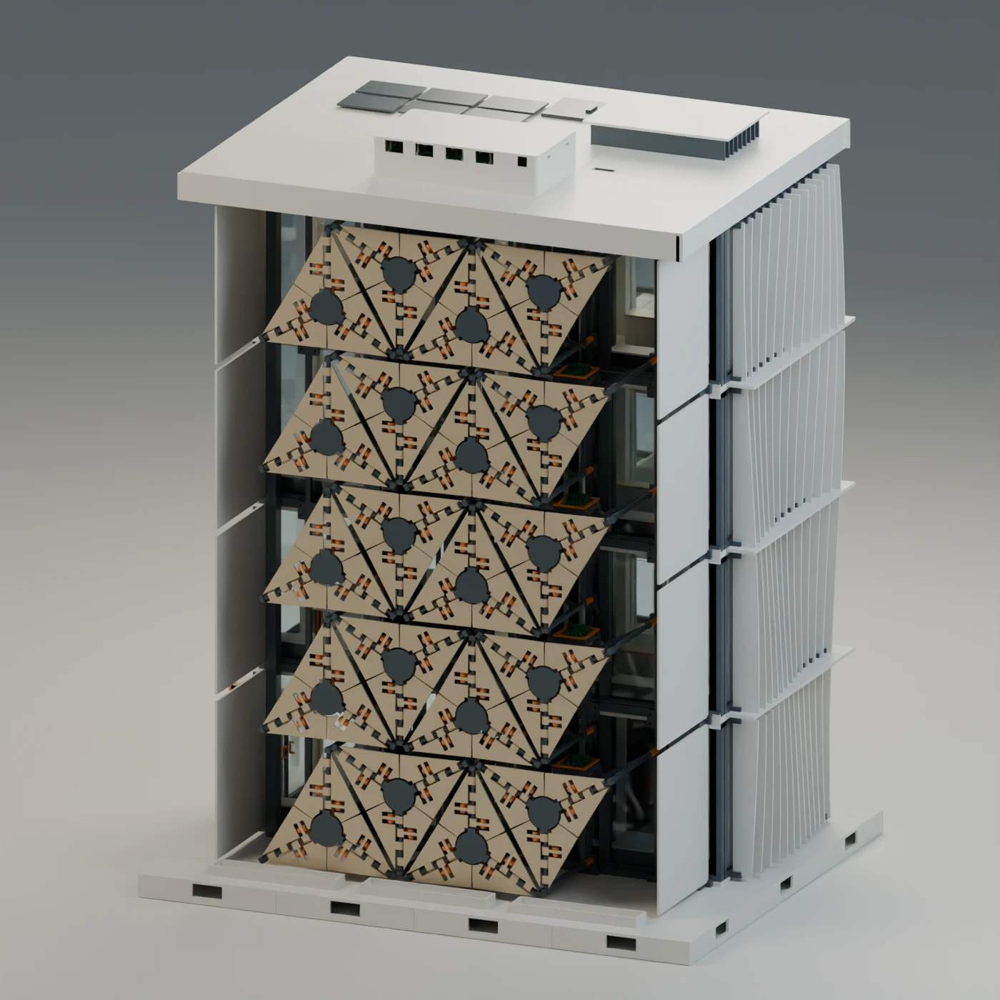
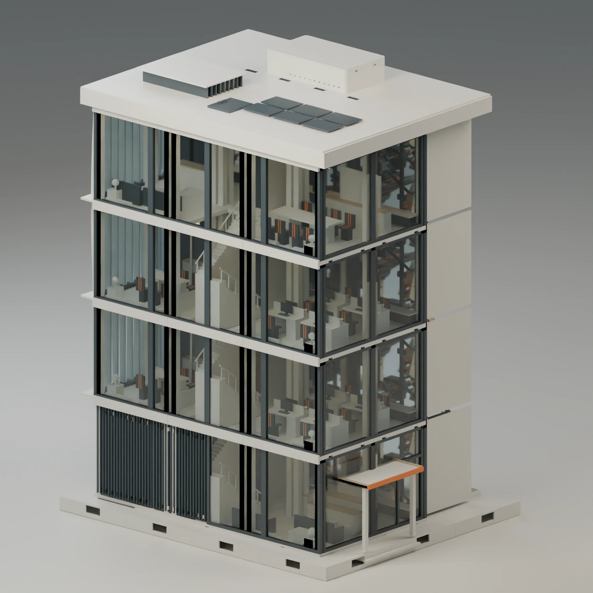
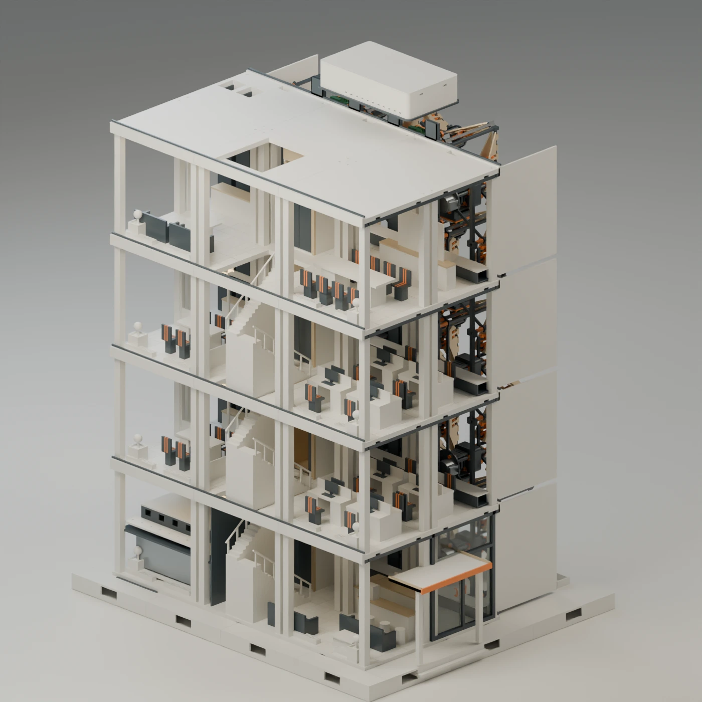
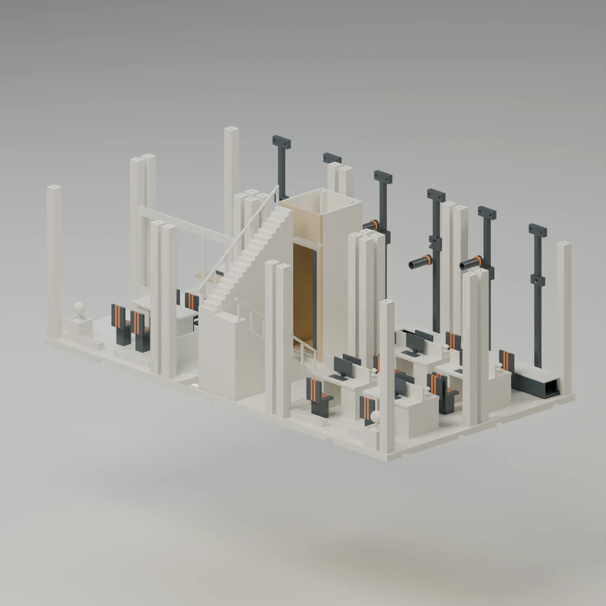
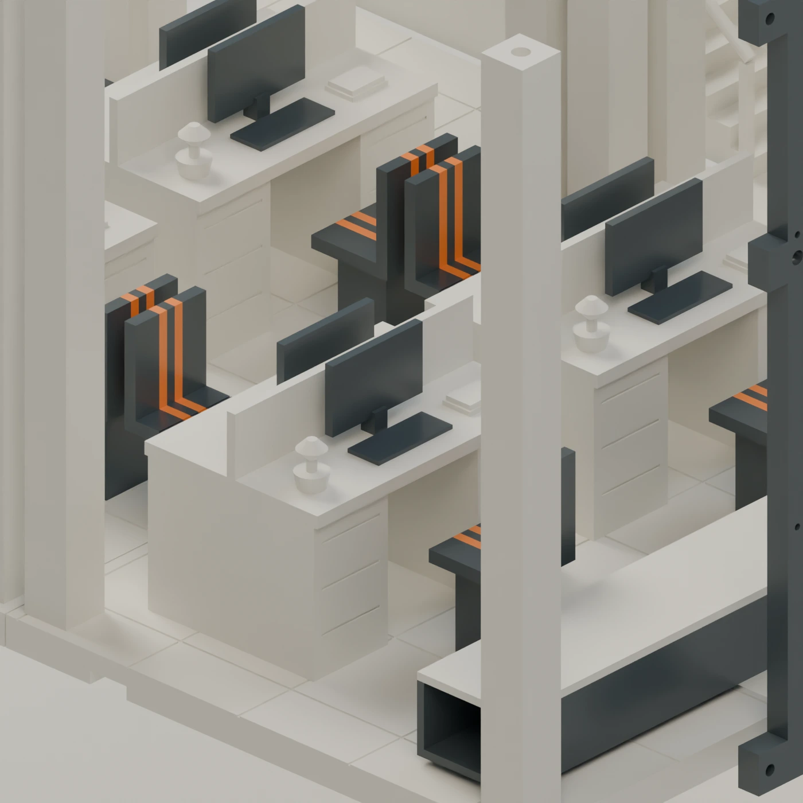
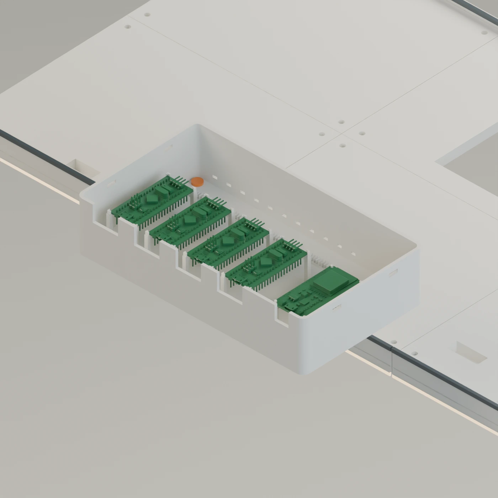

# The original twenty-module office building

The September 2026 integrated assembly places twenty motorized modules on
the front of a model office building. The ground floor and three upper
floors sit above a common base. Behind the facade are desks, circulation
space and a lift. The technical roof closes the building above the offices.

At frame 1 the transformed mesh bounds span approximately **672.6 mm in X,
544.6 mm in Y and 870.6 mm in Z**. This measurement includes the building
and mechanisms and excludes the studio ground plane. It describes the
display envelope at that pose.

## Inspect the moving facade

Open [COMPLETE_BUILDING_20.blend](../cad/original_20_module_building/COMPLETE_BUILDING_20.blend).
Press Space to play the saved timeline. The model has 2,667 scene objects,
including 940 with animation data. On its 960-frame timeline the rows and
columns have different phases. A leaf can be opening while its neighbour
is already closing. At the saved 24 frames per second, one cycle lasts
40 seconds. This sequence belongs to the building presentation. The current
seven-register controller runs its own fourteen-channel program.

| Front with leaves open | Front with leaves closed |
|---|---|
|  |  |

## Inspect the building behind the mechanisms

| Rear elevation | Cutaway |
|---|---|
|  |  |

| Office floor | Desks | Technical roof |
|---|---|---|
|  |  |  |

## Work with the engineering assembly

Open [the corrected FreeCAD assembly](../cad/original_20_module_building/COMPLETE_BUILDING_R6.FCStd).
Its model tree contains separate building levels and a SolarSkin group
with placements M01 through M20. Use the placement labels to locate a
particular mechanism while keeping the surrounding floor geometry visible.

The animated Blender file and the later R6 FreeCAD delivery are distinct
checkpoints. Use the Blender file for the original choreography and the
R6 file for that revision's mechanical placement. The newer four-plate
print set and reinforced stand have their own guides and interfaces.
