# Furnished office

The two views are rendered from the linked print file at independent scale. See the dimensions to distinguish similar parts.

### J01_CHEIE_FLUTURE
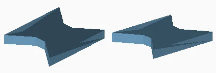

Quantity: 30. Material/color: matte_white_PLA. Size: 9.4 x 11.5 x 1.4 mm. Bed: 1, 4, 5, 6, 7, 8, 9.
[Print mesh](../../print/furnished/parts/J01_CHEIE_FLUTURE.stl)

### A01_PLANSEU_1
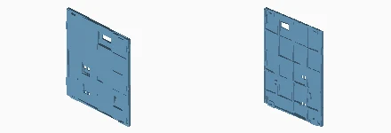

Quantity: 5. Material/color: matte_white_PLA. Size: 157.6 x 4.6 x 181.6 mm. Bed: 2.
[Print mesh](../../print/furnished/parts/A01_PLANSEU_1.stl)

### A01_PLANSEU_2
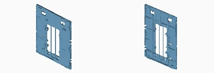

Quantity: 5. Material/color: matte_white_PLA. Size: 156.0 x 4.6 x 181.6 mm. Bed: 2.
[Print mesh](../../print/furnished/parts/A01_PLANSEU_2.stl)

### A01_PLANSEU_3
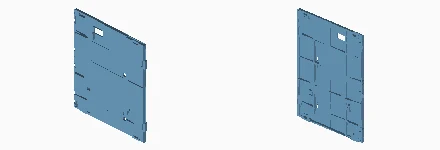

Quantity: 5. Material/color: matte_white_PLA. Size: 157.6 x 4.6 x 181.6 mm. Bed: 2, 3.
[Print mesh](../../print/furnished/parts/A01_PLANSEU_3.stl)

### A02_CADRU_SPATE
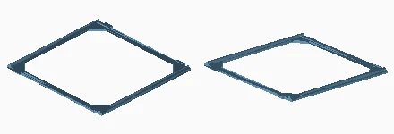

Quantity: 9. Material/color: matte_white_PLA. Size: 156.0 x 151.9 x 5.0 mm. Bed: 9, 10, 11, 12, 13, 14, 15, 16, 17.
[Print mesh](../../print/furnished/parts/A02_CADRU_SPATE.stl)

### A02_CADRU_SPATE_INALT
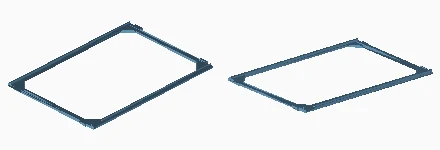

Quantity: 3. Material/color: matte_white_PLA. Size: 156.0 x 223.5 x 5.0 mm. Bed: 4, 5, 6.
[Print mesh](../../print/furnished/parts/A02_CADRU_SPATE_INALT.stl)

### S01_SCARA_RAMPA_INFERIOARA
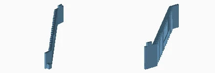

Quantity: 3. Material/color: orange_PLA. Size: 82.7 x 112.0 x 30.0 mm. Bed: 44, 45.
[Print mesh](../../print/furnished/parts/S01_SCARA_RAMPA_INFERIOARA.stl)

### S02_SCARA_RAMPA_SUPERIOARA
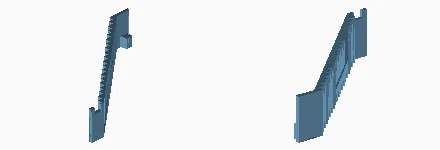

Quantity: 3. Material/color: orange_PLA. Size: 77.7 x 112.0 x 26.0 mm. Bed: 45, 46.
[Print mesh](../../print/furnished/parts/S02_SCARA_RAMPA_SUPERIOARA.stl)

### J03_PROBA_IMBINARI
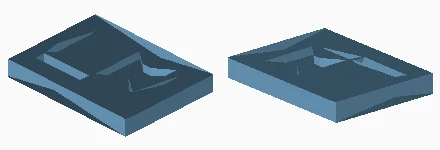

Quantity: 1. Material/color: matte_white_PLA. Size: 32.0 x 24.0 x 4.0 mm. Bed: 1.
[Print mesh](../../print/furnished/parts/J03_PROBA_IMBINARI.stl)

### E02_CUTIE_SURSA_12V
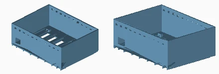

Quantity: 1. Material/color: matte_white_PLA. Size: 138.0 x 105.0 x 52.0 mm. Bed: 24.
[Print mesh](../../print/furnished/parts/E02_CUTIE_SURSA_12V.stl)

### E03_CAPAC_SURSA
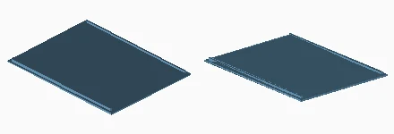

Quantity: 1. Material/color: matte_white_PLA. Size: 138.0 x 105.0 x 3.8 mm. Bed: 24.
[Print mesh](../../print/furnished/parts/E03_CAPAC_SURSA.stl)

### E04_BRIDA_SURSA
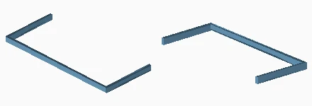

Quantity: 2. Material/color: orange_PLA. Size: 114.6 x 50.3 x 5.0 mm. Bed: 44.
[Print mesh](../../print/furnished/parts/E04_BRIDA_SURSA.stl)

### E05_CUTIE_COMANDA
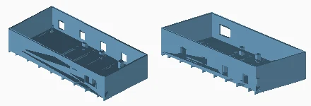

Quantity: 1. Material/color: matte_white_PLA. Size: 164.0 x 75.0 x 33.0 mm. Bed: 25.
[Print mesh](../../print/furnished/parts/E05_CUTIE_COMANDA.stl)

### E06_CAPAC_COMANDA
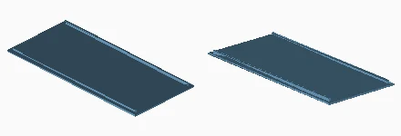

Quantity: 1. Material/color: matte_white_PLA. Size: 164.0 x 75.0 x 3.8 mm. Bed: 25.
[Print mesh](../../print/furnished/parts/E06_CAPAC_COMANDA.stl)

### E07_CANAL_ACOPERIS_1
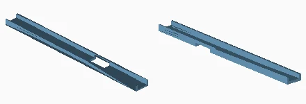

Quantity: 1. Material/color: matte_white_PLA. Size: 156.0 x 14.0 x 5.0 mm. Bed: 4.
[Print mesh](../../print/furnished/parts/E07_CANAL_ACOPERIS_1.stl)

### E07_CANAL_ACOPERIS_2
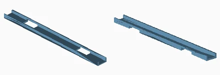

Quantity: 1. Material/color: matte_white_PLA. Size: 156.0 x 14.0 x 5.0 mm. Bed: 5.
[Print mesh](../../print/furnished/parts/E07_CANAL_ACOPERIS_2.stl)

### E07_CANAL_ACOPERIS_3
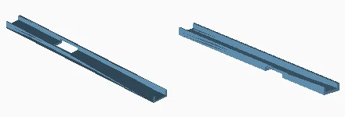

Quantity: 1. Material/color: matte_white_PLA. Size: 156.0 x 14.0 x 5.0 mm. Bed: 5.
[Print mesh](../../print/furnished/parts/E07_CANAL_ACOPERIS_3.stl)

### E08_CAPAC_CANAL_ACOPERIS
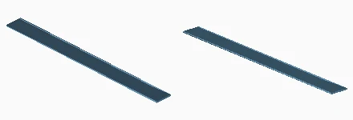

Quantity: 3. Material/color: matte_white_PLA. Size: 156.0 x 14.0 x 0.6 mm. Bed: 5, 6.
[Print mesh](../../print/furnished/parts/E08_CAPAC_CANAL_ACOPERIS.stl)

### T02_TRAPA_ACOPERIS
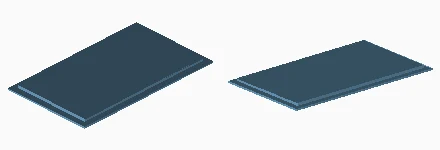

Quantity: 1. Material/color: matte_white_PLA. Size: 66.0 x 112.0 x 2.8 mm. Bed: 9.
[Print mesh](../../print/furnished/parts/T02_TRAPA_ACOPERIS.stl)

### B03_SOCLU_SPATE_CU_TALPA
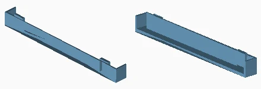

Quantity: 3. Material/color: anthracite_PLA. Size: 156.0 x 14.0 x 17.4 mm. Bed: 29.
[Print mesh](../../print/furnished/parts/B03_SOCLU_SPATE_CU_TALPA.stl)

### F01_BOLT_5_6
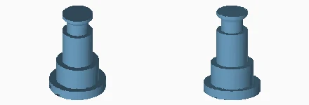

Quantity: 32. Material/color: matte_white_PLA. Size: 10.4 x 10.4 x 15.6 mm. Bed: 1, 10.
[Print mesh](../../print/furnished/parts/F01_BOLT_5_6.stl)

### F02_SIGURANTA_DUBLA
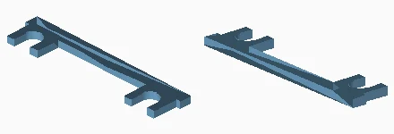

Quantity: 16. Material/color: matte_white_PLA. Size: 42.0 x 9.0 x 1.6 mm. Bed: 1, 4, 5, 6, 8, 9.
[Print mesh](../../print/furnished/parts/F02_SIGURANTA_DUBLA.stl)

### F05_CHEIE_VERTICALA
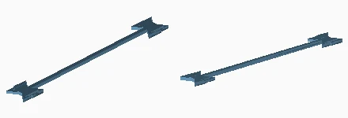

Quantity: 6. Material/color: matte_white_PLA. Size: 14.2 x 115.5 x 1.8 mm. Bed: 1, 6, 7, 8.
[Print mesh](../../print/furnished/parts/F05_CHEIE_VERTICALA.stl)

### F06_CHEIE_VERTICALA_LUNGA
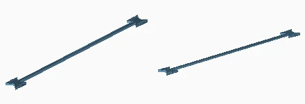

Quantity: 2. Material/color: matte_white_PLA. Size: 14.2 x 187.1 x 1.8 mm. Bed: 4.
[Print mesh](../../print/furnished/parts/F06_CHEIE_VERTICALA_LUNGA.stl)

### F07_CHEIE_ORIZONTALA
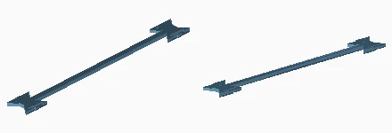

Quantity: 9. Material/color: matte_white_PLA. Size: 14.2 x 119.4 x 1.8 mm. Bed: 6, 7, 8, 9.
[Print mesh](../../print/furnished/parts/F07_CHEIE_ORIZONTALA.stl)

### F04_CASETA_C1_N1
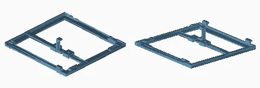

Quantity: 1. Material/color: anthracite_PLA. Size: 156.0 x 153.5 x 30.0 mm. Bed: 38.
[Print mesh](../../print/furnished/parts/F04_CASETA_C1_N1.stl)

### F04_CASETA_C1_N2
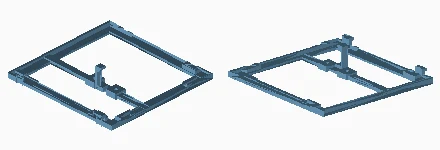

Quantity: 1. Material/color: anthracite_PLA. Size: 156.0 x 153.5 x 30.0 mm. Bed: 39.
[Print mesh](../../print/furnished/parts/F04_CASETA_C1_N2.stl)

### F04_CASETA_C1_N3
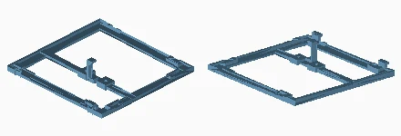

Quantity: 1. Material/color: anthracite_PLA. Size: 156.0 x 153.5 x 30.0 mm. Bed: 36.
[Print mesh](../../print/furnished/parts/F04_CASETA_C1_N3.stl)

### F04_CASETA_C1_N4
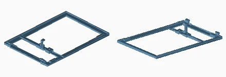

Quantity: 1. Material/color: anthracite_PLA. Size: 156.0 x 225.1 x 30.0 mm. Bed: 30.
[Print mesh](../../print/furnished/parts/F04_CASETA_C1_N4.stl)

### F04_CASETA_C2_N1
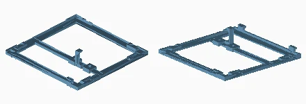

Quantity: 1. Material/color: anthracite_PLA. Size: 156.0 x 153.5 x 30.0 mm. Bed: 40.
[Print mesh](../../print/furnished/parts/F04_CASETA_C2_N1.stl)

### F04_CASETA_C2_N2

Quantity: 1. Material/color: anthracite_PLA. Size: 156.0 x 153.5 x 30.0 mm. Bed: 41.
[Print mesh](../../print/furnished/parts/F04_CASETA_C2_N2.stl)

### F04_CASETA_C2_N3
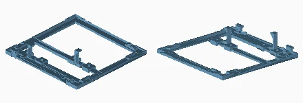

Quantity: 1. Material/color: anthracite_PLA. Size: 156.0 x 153.5 x 30.0 mm. Bed: 35.
[Print mesh](../../print/furnished/parts/F04_CASETA_C2_N3.stl)

### F04_CASETA_C2_N4
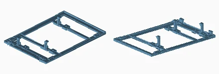

Quantity: 1. Material/color: anthracite_PLA. Size: 156.0 x 225.1 x 30.0 mm. Bed: 29.
[Print mesh](../../print/furnished/parts/F04_CASETA_C2_N4.stl)

### F04_CASETA_C3_N1
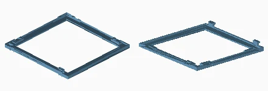

Quantity: 1. Material/color: anthracite_PLA. Size: 156.0 x 153.5 x 13.1 mm. Bed: 42.
[Print mesh](../../print/furnished/parts/F04_CASETA_C3_N1.stl)

### F04_CASETA_C3_N2
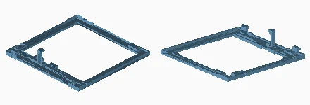

Quantity: 1. Material/color: anthracite_PLA. Size: 156.0 x 153.5 x 30.0 mm. Bed: 43.
[Print mesh](../../print/furnished/parts/F04_CASETA_C3_N2.stl)

### F04_CASETA_C3_N3
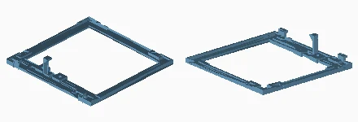

Quantity: 1. Material/color: anthracite_PLA. Size: 156.0 x 153.5 x 30.0 mm. Bed: 37.
[Print mesh](../../print/furnished/parts/F04_CASETA_C3_N3.stl)

### F04_CASETA_C3_N4
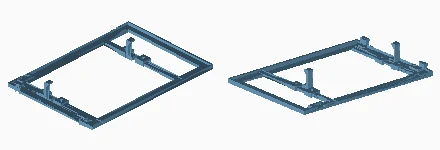

Quantity: 1. Material/color: anthracite_PLA. Size: 156.0 x 225.1 x 30.0 mm. Bed: 31.
[Print mesh](../../print/furnished/parts/F04_CASETA_C3_N4.stl)

### S03_BALUSTRADA_SEPARATA
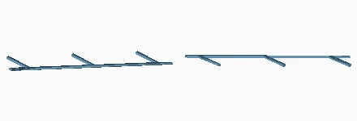

Quantity: 6. Material/color: matte_white_PLA. Size: 89.8 x 88.0 x 1.2 mm. Bed: 24, 26.
[Print mesh](../../print/furnished/parts/S03_BALUSTRADA_SEPARATA.stl)

### A05_LAMELE_UNDA_ASCENDENTA
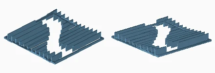

Quantity: 4. Material/color: matte_white_PLA. Size: 152.0 x 151.9 x 14.0 mm. Bed: 18, 19, 20, 21.
[Print mesh](../../print/furnished/parts/A05_LAMELE_UNDA_ASCENDENTA.stl)

### A06_LAMELE_UNDA_DESCENDENTA
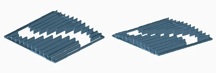

Quantity: 2. Material/color: matte_white_PLA. Size: 152.0 x 151.9 x 13.9 mm. Bed: 22, 23.
[Print mesh](../../print/furnished/parts/A06_LAMELE_UNDA_DESCENDENTA.stl)

### A07_LAMELE_UNDA_ETAJ_INALT
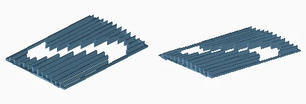

Quantity: 2. Material/color: matte_white_PLA. Size: 152.0 x 223.5 x 13.9 mm. Bed: 7, 8.
[Print mesh](../../print/furnished/parts/A07_LAMELE_UNDA_ETAJ_INALT.stl)

### B04_SOCLU_EVANTAI_INTEGRAT
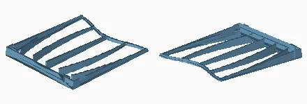

Quantity: 3. Material/color: anthracite_PLA. Size: 156.0 x 175.2 x 17.4 mm. Bed: 32, 33, 34.
[Print mesh](../../print/furnished/parts/B04_SOCLU_EVANTAI_INTEGRAT.stl)

### I01_RECEPTIE
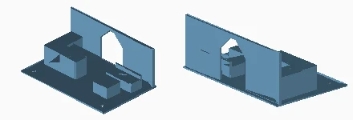

Quantity: 2. Material/color: matte_white_PLA. Size: 110.0 x 70.0 x 42.8 mm. Bed: 27.
[Print mesh](../../print/furnished/parts/I01_RECEPTIE.stl)

### I01_ATELIER
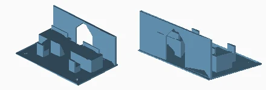

Quantity: 4. Material/color: matte_white_PLA. Size: 110.0 x 70.0 x 42.8 mm. Bed: 27, 28.
[Print mesh](../../print/furnished/parts/I01_ATELIER.stl)

### I01_SEDINTA
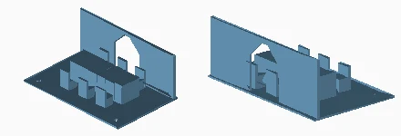

Quantity: 2. Material/color: matte_white_PLA. Size: 110.0 x 70.0 x 42.8 mm. Bed: 28.
[Print mesh](../../print/furnished/parts/I01_SEDINTA.stl)

### I02_BARA_POZITIONARE
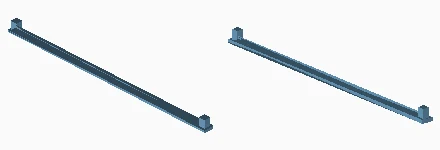

Quantity: 8. Material/color: matte_white_PLA. Size: 94.0 x 4.0 x 4.4 mm. Bed: 7, 8, 9.
[Print mesh](../../print/furnished/parts/I02_BARA_POZITIONARE.stl)

### I03_PROTECTIE_GOL_SCARA
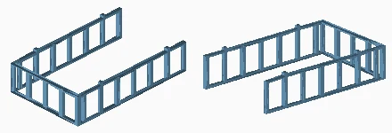

Quantity: 3. Material/color: matte_white_PLA. Size: 64.4 x 104.4 x 25.2 mm. Bed: 10, 11, 12.
[Print mesh](../../print/furnished/parts/I03_PROTECTIE_GOL_SCARA.stl)

