# Independent stand

The two views are rendered from the linked print file at independent scale. See the dimensions to distinguish similar parts.

### F04_FRAME_CASSETTE_C1_N1
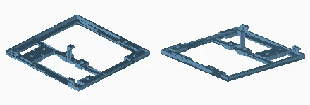

Quantity: 1. Material/color: anthracite. Size: 156.0 x 153.5 x 30.0 mm.
[Print mesh](../../print/02_frame/anthracite/25_F04_FRAME_CASSETTE_C1_N1__qty_01.stl)

### F04_FRAME_CASSETTE_C1_N2
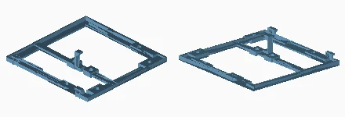

Quantity: 1. Material/color: anthracite. Size: 156.0 x 153.5 x 30.0 mm.
[Print mesh](../../print/02_frame/anthracite/26_F04_FRAME_CASSETTE_C1_N2__qty_01.stl)

### F04_FRAME_CASSETTE_C1_N3
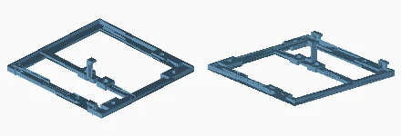

Quantity: 1. Material/color: anthracite. Size: 156.0 x 153.5 x 30.0 mm.
[Print mesh](../../print/02_frame/anthracite/27_F04_FRAME_CASSETTE_C1_N3__qty_01.stl)

### F04_FRAME_CASSETTE_C1_N4
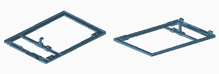

Quantity: 1. Material/color: anthracite. Size: 156.0 x 225.1 x 30.0 mm.
[Print mesh](../../print/02_frame/anthracite/28_F04_FRAME_CASSETTE_C1_N4__qty_01.stl)

### F04_FRAME_CASSETTE_C2_N1
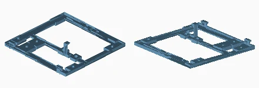

Quantity: 1. Material/color: anthracite. Size: 156.0 x 153.5 x 30.0 mm.
[Print mesh](../../print/02_frame/anthracite/29_F04_FRAME_CASSETTE_C2_N1__qty_01.stl)

### F04_FRAME_CASSETTE_C2_N2
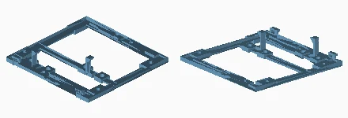

Quantity: 1. Material/color: anthracite. Size: 156.0 x 153.5 x 30.0 mm.
[Print mesh](../../print/02_frame/anthracite/30_F04_FRAME_CASSETTE_C2_N2__qty_01.stl)

### F04_FRAME_CASSETTE_C2_N3
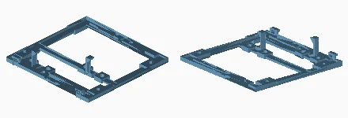

Quantity: 1. Material/color: anthracite. Size: 156.0 x 153.5 x 30.0 mm.
[Print mesh](../../print/02_frame/anthracite/31_F04_FRAME_CASSETTE_C2_N3__qty_01.stl)

### F04_FRAME_CASSETTE_C2_N4
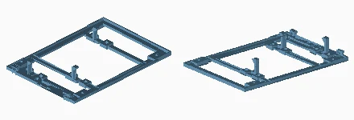

Quantity: 1. Material/color: anthracite. Size: 156.0 x 225.1 x 30.0 mm.
[Print mesh](../../print/02_frame/anthracite/32_F04_FRAME_CASSETTE_C2_N4__qty_01.stl)

### F04_FRAME_CASSETTE_C3_N1
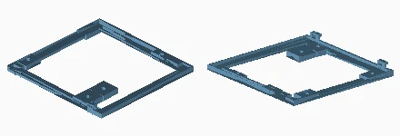

Quantity: 1. Material/color: anthracite. Size: 156.0 x 153.5 x 13.1 mm.
[Print mesh](../../print/02_frame/anthracite/33_F04_FRAME_CASSETTE_C3_N1__qty_01.stl)

### F04_FRAME_CASSETTE_C3_N2
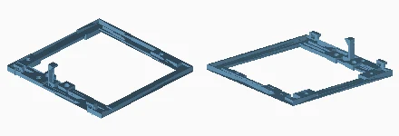

Quantity: 1. Material/color: anthracite. Size: 156.0 x 153.5 x 30.0 mm.
[Print mesh](../../print/02_frame/anthracite/34_F04_FRAME_CASSETTE_C3_N2__qty_01.stl)

### F04_FRAME_CASSETTE_C3_N3
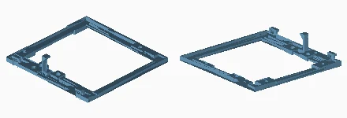

Quantity: 1. Material/color: anthracite. Size: 156.0 x 153.5 x 30.0 mm.
[Print mesh](../../print/02_frame/anthracite/35_F04_FRAME_CASSETTE_C3_N3__qty_01.stl)

### F04_FRAME_CASSETTE_C3_N4
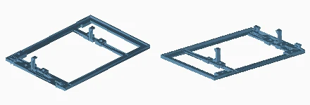

Quantity: 1. Material/color: anthracite. Size: 156.0 x 225.1 x 30.0 mm.
[Print mesh](../../print/02_frame/anthracite/36_F04_FRAME_CASSETTE_C3_N4__qty_01.stl)

### F10_CAPTIVE_CROSS_MEMBER
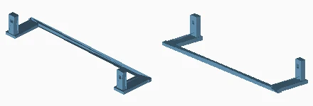

Quantity: 12. Material/color: white. Size: 132.0 x 29.6 x 18.5 mm.
[Print mesh](../../print/02_frame/white/40_F10_CAPTIVE_CROSS_MEMBER__qty_12.stl)

### F01_RECEIVER_BOLT
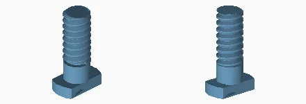

Quantity: 32. Material/color: white. Size: 5.8 x 10.4 x 18.4 mm.
[Print mesh](../../print/02_frame/white/23_F01_RECEIVER_BOLT__qty_32.stl)

### F02_DOUBLE_RECEIVER_NUT
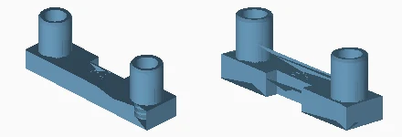

Quantity: 16. Material/color: white. Size: 42.0 x 10.0 x 15.1 mm.
[Print mesh](../../print/02_frame/white/24_F02_DOUBLE_RECEIVER_NUT__qty_16.stl)

### F05_VERTICAL_SPLICE
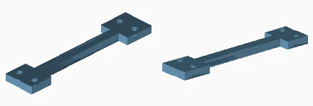

Quantity: 6. Material/color: white. Size: 25.6 x 119.6 x 6.0 mm.
[Print mesh](../../print/02_frame/white/37_F05_VERTICAL_SPLICE__qty_06.stl)

### F06_LONG_SPLICE
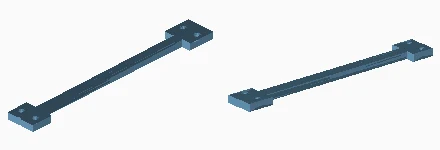

Quantity: 2. Material/color: white. Size: 25.6 x 191.2 x 6.0 mm.
[Print mesh](../../print/02_frame/white/38_F06_LONG_SPLICE__qty_02.stl)

### F07_HORIZONTAL_SPLICE
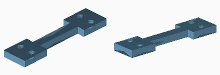

Quantity: 6. Material/color: white. Size: 22.0 x 88.0 x 6.0 mm.
[Print mesh](../../print/02_frame/white/39_F07_HORIZONTAL_SPLICE__qty_06.stl)

### F12_FRAME_BOLT
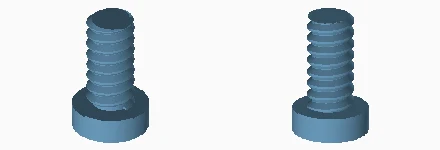

Quantity: 38. Material/color: white. Size: 9.4 x 9.4 x 15.0 mm.
[Print mesh](../../print/02_frame/white/63_F12_FRAME_BOLT__qty_38.stl)

### F13_PRESENTATION_FOOT
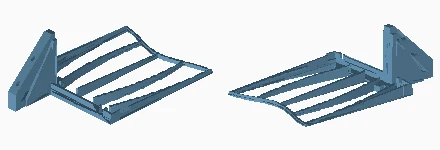

Quantity: 2. Material/color: anthracite. Size: 156.0 x 246.0 x 86.0 mm.
[Print mesh](../../print/02_frame/anthracite/64_F13_PRESENTATION_FOOT__qty_02.stl)

### F14_HEX_KEY
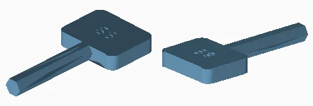

Quantity: 1. Material/color: white. Size: 18.0 x 38.0 x 3.9 mm.
[Print mesh](../../print/02_frame/white/65_F14_HEX_KEY__qty_01.stl)

### F15_CENTRAL_SPLICE
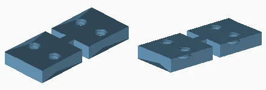

Quantity: 3. Material/color: white. Size: 22.0 x 52.0 x 6.0 mm.
[Print mesh](../../print/02_frame/white/66_F15_CENTRAL_SPLICE__qty_03.stl)

### F16_RECESSED_HEAD_BOLT
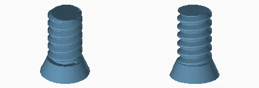

Quantity: 36. Material/color: white. Size: 8.2 x 8.2 x 11.5 mm.
[Print mesh](../../print/02_frame/white/67_F16_RECESSED_HEAD_BOLT__qty_36.stl)

### F17_LONG_RECEIVER_KEY
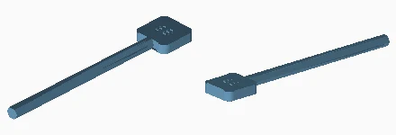

Quantity: 1. Material/color: white. Size: 12.0 x 67.0 x 3.0 mm.
[Print mesh](../../print/02_frame/white/68_F17_LONG_RECEIVER_KEY__qty_01.stl)

### F18_RIGHT_BASE_FOOT
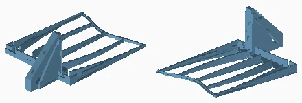

Quantity: 1. Material/color: anthracite. Size: 156.0 x 246.0 x 86.0 mm.
[Print mesh](../../print/02_frame/anthracite/69_F18_RIGHT_BASE_FOOT__qty_01.stl)

