# One mechanism

The two views are rendered from the linked print file at independent scale. See the dimensions to distinguish similar parts.

### P04_FRONT_HUB
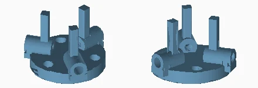

Quantity: 1. Material/color: windows_blue. Size: 42.5 x 41.5 x 29.0 mm.
[Print mesh](../../print/01_mechanism/one_module/windows_blue/P04_FRONT_HUB__qty_01.stl)

### P05_PILLAR
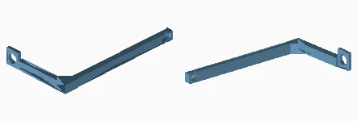

Quantity: 3. Material/color: windows_blue. Size: 61.0 x 110.9 x 14.0 mm.
[Print mesh](../../print/01_mechanism/one_module/windows_blue/P05_PILLAR__qty_03.stl)

### P36_DRIVER_TRAY_BUSHING
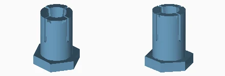

Quantity: 1. Material/color: windows_blue. Size: 12.0 x 10.4 x 14.2 mm.
[Print mesh](../../print/01_mechanism/one_module/windows_blue/P36_DRIVER_TRAY_BUSHING__qty_01.stl)

### P37_DRIVER_TRAY_CONE
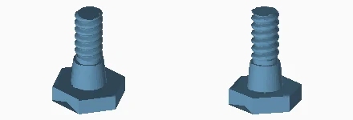

Quantity: 1. Material/color: orange. Size: 11.0 x 9.5 x 14.4 mm.
[Print mesh](../../print/01_mechanism/one_module/orange/P37_DRIVER_TRAY_CONE__qty_01.stl)

### P08_WING_AXLE
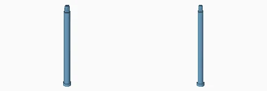

Quantity: 3. Material/color: windows_blue. Size: 7.0 x 7.0 x 85.0 mm.
[Print mesh](../../print/01_mechanism/one_module/windows_blue/P08_WING_AXLE__qty_03.stl)

### P07L_LEFT_WING
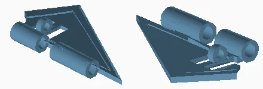

Quantity: 3. Material/color: white. Size: 75.6 x 43.9 x 8.8 mm.
[Print mesh](../../print/01_mechanism/one_module/white/P07L_LEFT_WING__qty_03.stl)

### P16_LINK_ROD
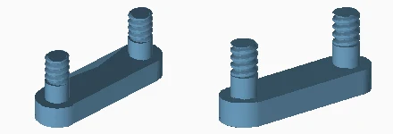

Quantity: 6. Material/color: orange. Size: 7.4 x 27.4 x 12.0 mm.
[Print mesh](../../print/01_mechanism/one_module/orange/P16_LINK_ROD__qty_06.stl)

### P32_AXLE_NUT
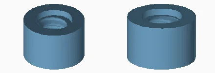

Quantity: 12. Material/color: orange. Size: 8.0 x 8.0 x 5.2 mm.
[Print mesh](../../print/01_mechanism/one_module/orange/P32_AXLE_NUT__qty_12.stl)

### P07R_RIGHT_WING
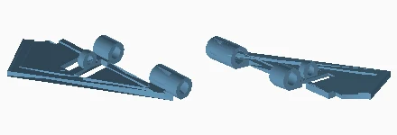

Quantity: 3. Material/color: white. Size: 77.5 x 43.9 x 8.8 mm.
[Print mesh](../../print/01_mechanism/one_module/white/P07R_RIGHT_WING__qty_03.stl)

### P33_EXPANSION_BUSHING
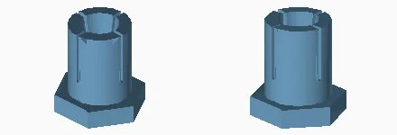

Quantity: 2. Material/color: windows_blue. Size: 12.0 x 10.4 x 12.2 mm.
[Print mesh](../../print/01_mechanism/one_module/windows_blue/P33_EXPANSION_BUSHING__qty_02.stl)

### P34_CLAMP_CONE
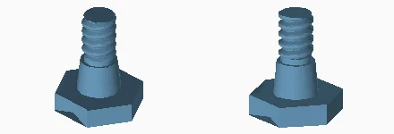

Quantity: 2. Material/color: orange. Size: 11.0 x 9.5 x 12.4 mm.
[Print mesh](../../print/01_mechanism/one_module/orange/P34_CLAMP_CONE__qty_02.stl)

### P09_D_PROFILE_GUIDE
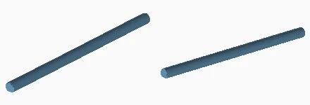

Quantity: 3. Material/color: windows_blue. Size: 6.0 x 112.7 x 5.4 mm.
[Print mesh](../../print/01_mechanism/one_module/windows_blue/P09_D_PROFILE_GUIDE__qty_03.stl)

### P10_CARRIAGE
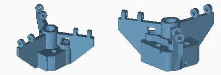

Quantity: 1. Material/color: windows_blue. Size: 85.1 x 73.8 x 42.2 mm.
[Print mesh](../../print/01_mechanism/one_module/windows_blue/P10_CARRIAGE__qty_01.stl)

### P12_LOWER_SPLIT_NUT
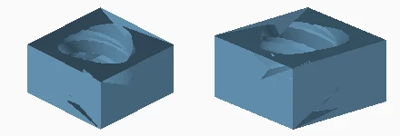

Quantity: 1. Material/color: windows_blue. Size: 13.0 x 13.0 x 7.0 mm.
[Print mesh](../../print/01_mechanism/one_module/windows_blue/P12_LOWER_SPLIT_NUT__qty_01.stl)

### P26_UPPER_SPLIT_NUT
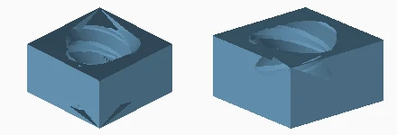

Quantity: 1. Material/color: windows_blue. Size: 13.0 x 13.0 x 7.0 mm.
[Print mesh](../../print/01_mechanism/one_module/windows_blue/P26_UPPER_SPLIT_NUT__qty_01.stl)

### P11_CARRIAGE_COVER
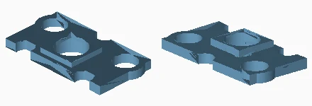

Quantity: 1. Material/color: windows_blue. Size: 42.4 x 22.0 x 5.1 mm.
[Print mesh](../../print/01_mechanism/one_module/windows_blue/P11_CARRIAGE_COVER__qty_01.stl)

### P29_COVER_SCREW
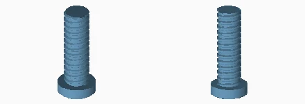

Quantity: 2. Material/color: windows_blue. Size: 12.0 x 12.0 x 29.0 mm.
[Print mesh](../../print/01_mechanism/one_module/windows_blue/P29_COVER_SCREW__qty_02.stl)

### P13_THREE_START_LEAD_SCREW
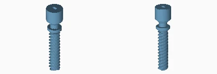

Quantity: 1. Material/color: orange. Size: 16.0 x 16.0 x 68.3 mm.
[Print mesh](../../print/01_mechanism/one_module/orange/P13_THREE_START_LEAD_SCREW__qty_01.stl)

### P02_REAR_FRAME
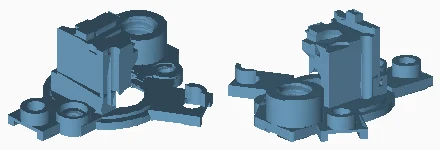

Quantity: 1. Material/color: windows_blue. Size: 86.2 x 87.0 x 37.5 mm.
[Print mesh](../../print/01_mechanism/one_module/windows_blue/P02_REAR_FRAME__qty_01.stl)

### P44_FRAME_CONNECTOR
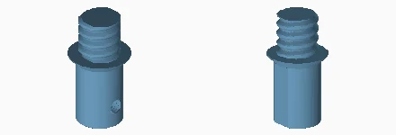

Quantity: 1. Material/color: orange. Size: 24.0 x 24.0 x 44.0 mm.
[Print mesh](../../print/01_mechanism/one_module/orange/P44_FRAME_CONNECTOR__qty_01.stl)

### P45_D_PROFILE_RECEIVER
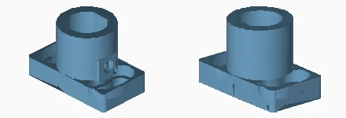

Quantity: 1. Material/color: windows_blue. Size: 46.0 x 26.0 x 30.0 mm.
[Print mesh](../../print/01_mechanism/one_module/windows_blue/P45_D_PROFILE_RECEIVER__qty_01.stl)

### P46_RECEIVER_CROSS_SCREW
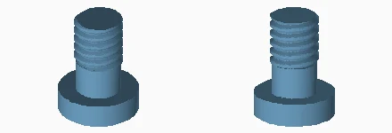

Quantity: 1. Material/color: orange. Size: 10.0 x 10.0 x 12.8 mm.
[Print mesh](../../print/01_mechanism/one_module/orange/P46_RECEIVER_CROSS_SCREW__qty_01.stl)

### P03_MOTOR_CLAMP
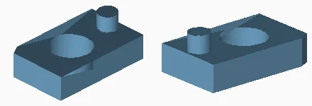

Quantity: 2. Material/color: windows_blue. Size: 13.0 x 21.0 x 8.3 mm.
[Print mesh](../../print/01_mechanism/one_module/windows_blue/P03_MOTOR_CLAMP__qty_02.stl)

### P30_MOTOR_SCREW
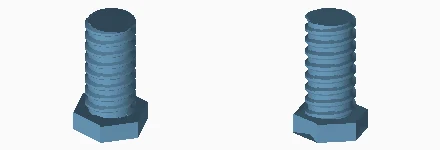

Quantity: 2. Material/color: orange. Size: 12.0 x 10.4 x 19.0 mm.
[Print mesh](../../print/01_mechanism/one_module/orange/P30_MOTOR_SCREW__qty_02.stl)

### P31_MOTOR_LOCKNUT
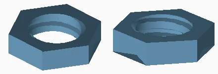

Quantity: 2. Material/color: windows_blue. Size: 13.0 x 11.3 x 3.0 mm.
[Print mesh](../../print/01_mechanism/one_module/windows_blue/P31_MOTOR_LOCKNUT__qty_02.stl)

### E01_DRIVER_TRAY
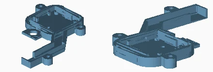

Quantity: 1. Material/color: windows_blue. Size: 80.0 x 95.5 x 7.8 mm.
[Print mesh](../../print/01_mechanism/one_module/windows_blue/E01_DRIVER_TRAY__qty_01.stl)

### E02_DRIVER_COVER
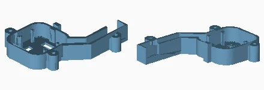

Quantity: 1. Material/color: windows_blue. Size: 80.0 x 95.5 x 17.6 mm.
[Print mesh](../../print/01_mechanism/one_module/windows_blue/E02_DRIVER_COVER__qty_01.stl)

### E03_DRIVER_COVER_SCREW
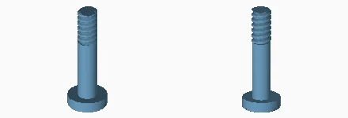

Quantity: 3. Material/color: windows_blue. Size: 8.0 x 8.0 x 22.0 mm.
[Print mesh](../../print/01_mechanism/one_module/windows_blue/E03_DRIVER_COVER_SCREW__qty_03.stl)

