# Optional architectural revision

The two views are rendered from the linked print file at independent scale. See the dimensions to distinguish similar parts.

### 11_A07_FINS_WAVE_FLOOR_TALL
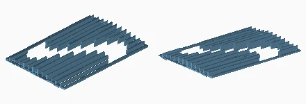

Quantity: 02. Material/color: white. Size: 152.0 x 223.5 x 13.9 mm.
[Print mesh](../../print/07_building_optional/white/11_A07_FINS_WAVE_FLOOR_TALL.stl)

### 46_I02_STRIP_WHITE

Quantity: 02. Material/color: white. Size: 94.0 x 4.0 x 4.4 mm.
[Print mesh](../../print/07_building_optional/white/46_I02_STRIP_WHITE.stl)

### 08_A02_FRAME_REAR_TALL
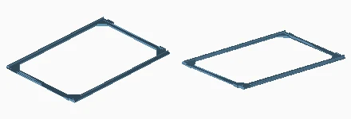

Quantity: 03. Material/color: white. Size: 156.0 x 223.5 x 5.0 mm.
[Print mesh](../../print/07_building_optional/white/08_A02_FRAME_REAR_TALL.stl)

### 22_E08_LID_CHANNEL_ROOF
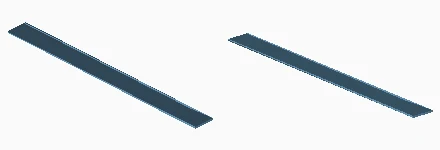

Quantity: 03. Material/color: white. Size: 156.0 x 14.0 x 0.6 mm.
[Print mesh](../../print/07_building_optional/white/22_E08_LID_CHANNEL_ROOF.stl)

### 56_I05_FRAME_SHEET_PETG
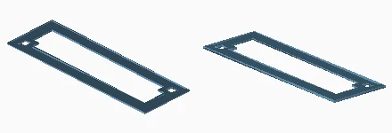

Quantity: 02. Material/color: white. Size: 59.6 x 19.6 x 0.6 mm.
[Print mesh](../../print/07_building_optional/white/56_I05_FRAME_SHEET_PETG.stl)

### 07_A02_FRAME_REAR
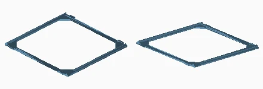

Quantity: 09. Material/color: white. Size: 156.0 x 151.9 x 5.0 mm.
[Print mesh](../../print/07_building_optional/white/07_A02_FRAME_REAR.stl)

### 19_E07_CHANNEL_ROOF_1
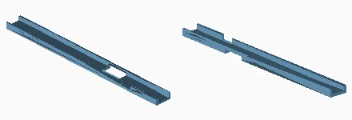

Quantity: 01. Material/color: white. Size: 156.0 x 14.0 x 5.0 mm.
[Print mesh](../../print/07_building_optional/white/19_E07_CHANNEL_ROOF_1.stl)

### 18_E06_LID_CONTROLLER
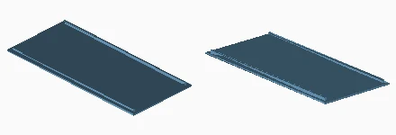

Quantity: 01. Material/color: white. Size: 164.0 x 75.0 x 3.8 mm.
[Print mesh](../../print/07_building_optional/white/18_E06_LID_CONTROLLER.stl)

### 44_I01_LOUNGE
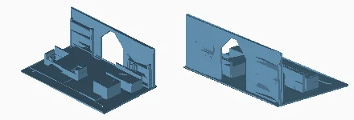

Quantity: 01. Material/color: white. Size: 110.0 x 70.0 x 42.8 mm.
[Print mesh](../../print/07_building_optional/white/44_I01_LOUNGE.stl)

### 04_A01_FLOOR_2
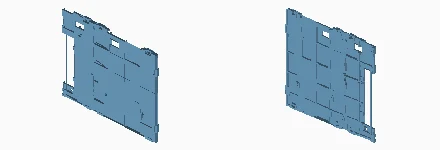

Quantity: 03. Material/color: white. Size: 235.6 x 4.6 x 183.6 mm.
[Print mesh](../../print/07_building_optional/white/04_A01_FLOOR_2.stl)

### 43_I01_RECEPTION
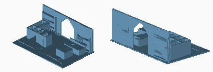

Quantity: 01. Material/color: white. Size: 110.0 x 70.0 x 42.8 mm.
[Print mesh](../../print/07_building_optional/white/43_I01_RECEPTION.stl)

### 03_A01_FLOOR_1
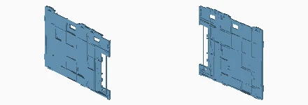

Quantity: 03. Material/color: white. Size: 235.6 x 4.6 x 183.6 mm.
[Print mesh](../../print/07_building_optional/white/03_A01_FLOOR_1.stl)

### 42_I01_WORKSHOP
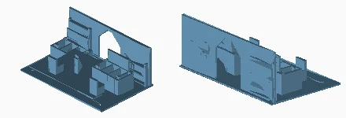

Quantity: 04. Material/color: white. Size: 110.0 x 70.0 x 42.8 mm.
[Print mesh](../../print/07_building_optional/white/42_I01_WORKSHOP.stl)

### 09_A05_FINS_WAVE_RISING
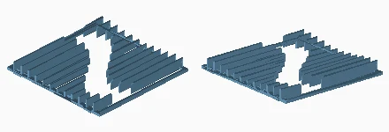

Quantity: 04. Material/color: white. Size: 152.0 x 151.9 x 14.0 mm.
[Print mesh](../../print/07_building_optional/white/09_A05_FINS_WAVE_RISING.stl)

### 06_A01_GROUND_FLOOR_2
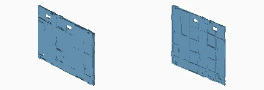

Quantity: 01. Material/color: white. Size: 235.6 x 4.6 x 183.6 mm.
[Print mesh](../../print/07_building_optional/white/06_A01_GROUND_FLOOR_2.stl)

### 45_I01_MEETING_ROOM
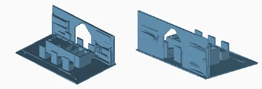

Quantity: 02. Material/color: white. Size: 110.0 x 70.0 x 42.8 mm.
[Print mesh](../../print/07_building_optional/white/45_I01_MEETING_ROOM.stl)

### 41_F11_KEY_TRANSVERSALA
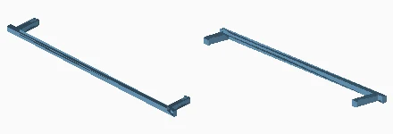

Quantity: 12. Material/color: white. Size: 132.0 x 17.2 x 3.2 mm.
[Print mesh](../../print/07_building_optional/white/41_F11_KEY_TRANSVERSALA.stl)

### 17_E05_BOX_CONTROLLER
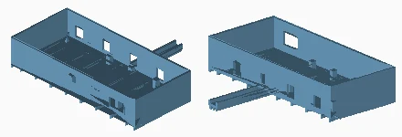

Quantity: 01. Material/color: white. Size: 164.0 x 134.0 x 33.0 mm.
[Print mesh](../../print/07_building_optional/white/17_E05_BOX_CONTROLLER.stl)

### 10_A06_FINS_WAVE_FALLING
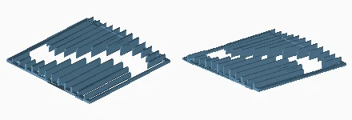

Quantity: 02. Material/color: white. Size: 152.0 x 151.9 x 13.9 mm.
[Print mesh](../../print/07_building_optional/white/10_A06_FINS_WAVE_FALLING.stl)

### 62_T02_HATCH_ROOF
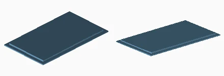

Quantity: 01. Material/color: white. Size: 66.0 x 112.0 x 2.8 mm.
[Print mesh](../../print/07_building_optional/white/62_T02_HATCH_ROOF.stl)

### 14_E02_BOX_POWER_SUPPLY_12V
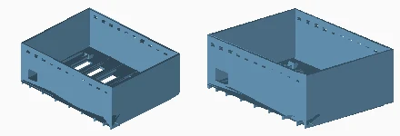

Quantity: 01. Material/color: white. Size: 138.0 x 105.0 x 52.0 mm.
[Print mesh](../../print/07_building_optional/white/14_E02_BOX_POWER_SUPPLY_12V.stl)

### 61_S03_RAILING_SEPARATE
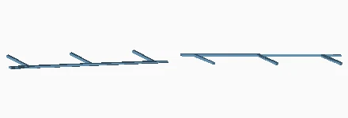

Quantity: 06. Material/color: white. Size: 89.8 x 88.0 x 1.2 mm.
[Print mesh](../../print/07_building_optional/white/61_S03_RAILING_SEPARATE.stl)

### 21_E07_CHANNEL_ROOF_3
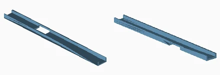

Quantity: 01. Material/color: white. Size: 156.0 x 14.0 x 5.0 mm.
[Print mesh](../../print/07_building_optional/white/21_E07_CHANNEL_ROOF_3.stl)

### 05_A01_GROUND_FLOOR_1
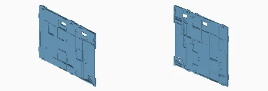

Quantity: 01. Material/color: white. Size: 235.6 x 4.6 x 183.6 mm.
[Print mesh](../../print/07_building_optional/white/05_A01_GROUND_FLOOR_1.stl)

### 20_E07_CHANNEL_ROOF_2
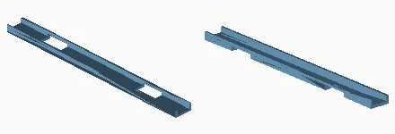

Quantity: 01. Material/color: white. Size: 156.0 x 14.0 x 5.0 mm.
[Print mesh](../../print/07_building_optional/white/20_E07_CHANNEL_ROOF_2.stl)

### 01_A01_ROOF_1
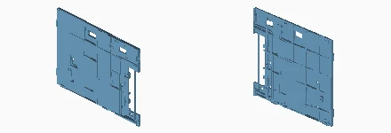

Quantity: 01. Material/color: white. Size: 235.6 x 4.6 x 182.0 mm.
[Print mesh](../../print/07_building_optional/white/01_A01_ROOF_1.stl)

### 15_E03_LID_POWER_SUPPLY
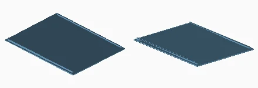

Quantity: 01. Material/color: white. Size: 138.0 x 105.0 x 3.8 mm.
[Print mesh](../../print/07_building_optional/white/15_E03_LID_POWER_SUPPLY.stl)

### 50_I03_GUARD_OPENING_STAIR
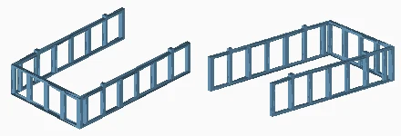

Quantity: 03. Material/color: white. Size: 64.4 x 104.4 x 25.2 mm.
[Print mesh](../../print/07_building_optional/white/50_I03_GUARD_OPENING_STAIR.stl)

### 58_J04_KEY_FLOOR_SLAB_U
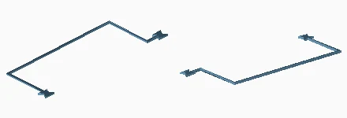

Quantity: 05. Material/color: white. Size: 57.7 x 166.5 x 1.4 mm.
[Print mesh](../../print/07_building_optional/white/58_J04_KEY_FLOOR_SLAB_U.stl)

### 02_A01_ROOF_2
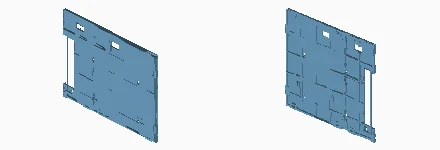

Quantity: 01. Material/color: white. Size: 235.6 x 4.6 x 182.0 mm.
[Print mesh](../../print/07_building_optional/white/02_A01_ROOF_2.stl)

### 55_I04_ACCENT_MEETING_ROOM_GREEN
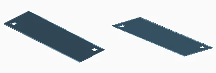

Quantity: 02. Material/color: green. Size: 59.6 x 19.6 x 0.2 mm.
[Print mesh](../../print/07_building_optional/green/55_I04_ACCENT_MEETING_ROOM_GREEN.stl)

### 51_I04_ACCENT_WORKSHOP_BLUE
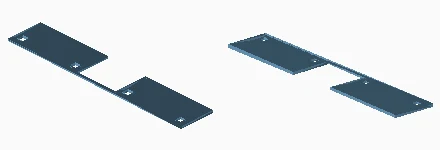

Quantity: 02. Material/color: blue. Size: 91.6 x 17.0 x 0.8 mm.
[Print mesh](../../print/07_building_optional/blue/51_I04_ACCENT_WORKSHOP_BLUE.stl)

### 47_I02_STRIP_BLUE

Quantity: 02. Material/color: blue. Size: 94.0 x 4.0 x 4.4 mm.
[Print mesh](../../print/07_building_optional/blue/47_I02_STRIP_BLUE.stl)

### 53_I04_ACCENT_RECEPTION_YELLOW
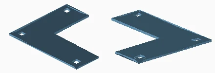

Quantity: 01. Material/color: white. Size: 41.6 x 35.6 x 0.8 mm.
[Print mesh](../../print/07_building_optional/white/53_I04_ACCENT_RECEPTION_YELLOW.stl)

### 48_I02_STRIP_YELLOW

Quantity: 01. Material/color: white. Size: 94.0 x 4.0 x 4.4 mm.
[Print mesh](../../print/07_building_optional/white/48_I02_STRIP_YELLOW.stl)

### 12_B03_BASE_REAR_WITH_FOOT
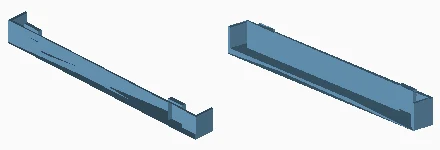

Quantity: 03. Material/color: anthracite. Size: 156.0 x 14.0 x 17.4 mm.
[Print mesh](../../print/07_building_optional/anthracite/12_B03_BASE_REAR_WITH_FOOT.stl)

### 13_B04_BASE_FAN_INTEGRATED
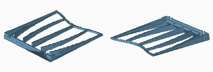

Quantity: 03. Material/color: anthracite. Size: 156.0 x 175.2 x 17.4 mm.
[Print mesh](../../print/07_building_optional/anthracite/13_B04_BASE_FAN_INTEGRATED.stl)

### 52_I04_ACCENT_WORKSHOP_ORANGE

Quantity: 02. Material/color: orange. Size: 91.6 x 17.0 x 0.8 mm.
[Print mesh](../../print/07_building_optional/orange/52_I04_ACCENT_WORKSHOP_ORANGE.stl)

### 54_I04_ACCENT_LOUNGE_ORANGE
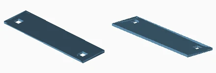

Quantity: 01. Material/color: orange. Size: 41.6 x 11.4 x 0.8 mm.
[Print mesh](../../print/07_building_optional/orange/54_I04_ACCENT_LOUNGE_ORANGE.stl)

### 16_E04_CLAMP_POWER_SUPPLY
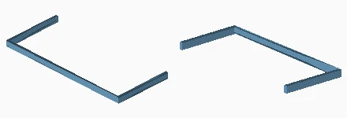

Quantity: 02. Material/color: orange. Size: 114.6 x 50.3 x 5.0 mm.
[Print mesh](../../print/07_building_optional/orange/16_E04_CLAMP_POWER_SUPPLY.stl)

### 60_S02_STAIR_FLIGHT_UPPER
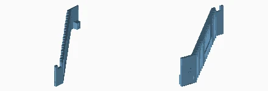

Quantity: 03. Material/color: orange. Size: 77.7 x 112.0 x 26.0 mm.
[Print mesh](../../print/07_building_optional/orange/60_S02_STAIR_FLIGHT_UPPER.stl)

### 49_I02_STRIP_ORANGE
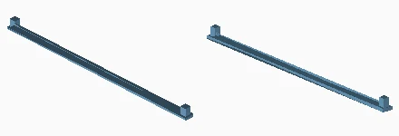

Quantity: 03. Material/color: orange. Size: 94.0 x 4.0 x 4.4 mm.
[Print mesh](../../print/07_building_optional/orange/49_I02_STRIP_ORANGE.stl)

### 59_S01_STAIR_FLIGHT_LOWER
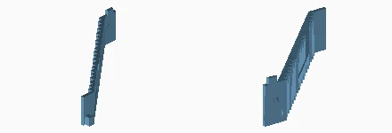

Quantity: 03. Material/color: orange. Size: 82.7 x 112.0 x 30.0 mm.
[Print mesh](../../print/07_building_optional/orange/59_S01_STAIR_FLIGHT_LOWER.stl)

