# Simplified office

The two views are rendered from the linked print file at independent scale. See the dimensions to distinguish similar parts.

### J01_CHEIE_FLUTURE
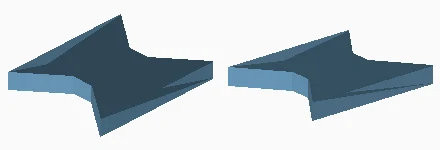

Quantity: 30. Material/color: matte_white_PLA. Size: 9.4 x 11.5 x 1.4 mm. Bed: 1, 26.
[Print mesh](../../print/simplified/parts/J01_CHEIE_FLUTURE.stl)

### A01_PLANSEU_1
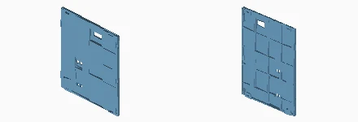

Quantity: 5. Material/color: matte_white_PLA. Size: 157.6 x 4.6 x 181.6 mm. Bed: 2.
[Print mesh](../../print/simplified/parts/A01_PLANSEU_1.stl)

### A01_PLANSEU_2
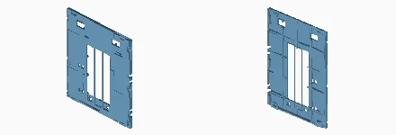

Quantity: 5. Material/color: matte_white_PLA. Size: 156.0 x 4.6 x 181.6 mm. Bed: 2.
[Print mesh](../../print/simplified/parts/A01_PLANSEU_2.stl)

### A01_PLANSEU_3
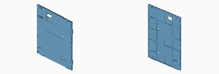

Quantity: 5. Material/color: matte_white_PLA. Size: 157.6 x 4.6 x 181.6 mm. Bed: 2, 3.
[Print mesh](../../print/simplified/parts/A01_PLANSEU_3.stl)

### A02_CADRU_SPATE
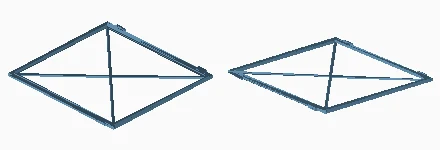

Quantity: 9. Material/color: matte_white_PLA. Size: 156.0 x 151.9 x 2.8 mm. Bed: 35, 36, 37, 38, 39, 40, 41, 42, 43.
[Print mesh](../../print/simplified/parts/A02_CADRU_SPATE.stl)

### V01_VITRAJ_SPATE
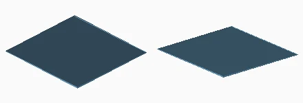

Quantity: 9. Material/color: translucent_green_PETG. Size: 150.8 x 144.1 x 0.2 mm. Bed: 9, 10, 11, 12, 13, 14, 15, 16, 17.
[Print mesh](../../print/simplified/parts/V01_VITRAJ_SPATE.stl)

### A03_CADRU_LATERAL
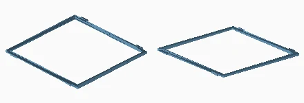

Quantity: 6. Material/color: matte_white_PLA. Size: 152.0 x 151.9 x 2.8 mm. Bed: 50, 51, 52, 53, 54, 55.
[Print mesh](../../print/simplified/parts/A03_CADRU_LATERAL.stl)

### V02_VITRAJ_LATERAL
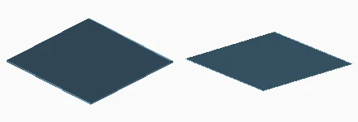

Quantity: 6. Material/color: translucent_green_PETG. Size: 146.8 x 144.1 x 0.2 mm. Bed: 18, 19, 20, 21, 22, 23.
[Print mesh](../../print/simplified/parts/V02_VITRAJ_LATERAL.stl)

### A02_CADRU_SPATE_INALT
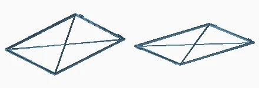

Quantity: 3. Material/color: matte_white_PLA. Size: 156.0 x 223.5 x 2.8 mm. Bed: 24, 25, 26.
[Print mesh](../../print/simplified/parts/A02_CADRU_SPATE_INALT.stl)

### V01_VITRAJ_SPATE_INALT
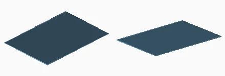

Quantity: 3. Material/color: translucent_green_PETG. Size: 150.8 x 215.7 x 0.2 mm. Bed: 4, 5, 6.
[Print mesh](../../print/simplified/parts/V01_VITRAJ_SPATE_INALT.stl)

### A03_CADRU_LATERAL_INALT
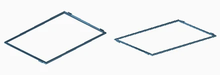

Quantity: 2. Material/color: matte_white_PLA. Size: 152.0 x 223.5 x 2.8 mm. Bed: 30, 31.
[Print mesh](../../print/simplified/parts/A03_CADRU_LATERAL_INALT.stl)

### V02_VITRAJ_LATERAL_INALT
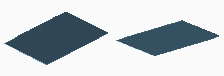

Quantity: 2. Material/color: translucent_green_PETG. Size: 146.8 x 215.7 x 0.2 mm. Bed: 7, 8.
[Print mesh](../../print/simplified/parts/V02_VITRAJ_LATERAL_INALT.stl)

### J02_SURUB_RECEPTOR_D8
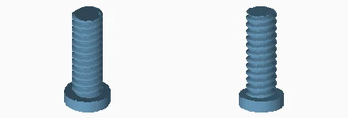

Quantity: 32. Material/color: matte_white_PLA. Size: 12.0 x 12.0 x 27.0 mm. Bed: 24, 25.
[Print mesh](../../print/simplified/parts/J02_SURUB_RECEPTOR_D8.stl)

### A04_PORTANT_1_N1
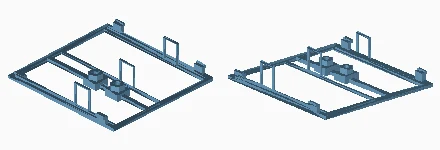

Quantity: 1. Material/color: matte_white_PLA. Size: 156.0 x 151.9 x 30.0 mm. Bed: 44.
[Print mesh](../../print/simplified/parts/A04_PORTANT_1_N1.stl)

### A04_PORTANT_1_N2
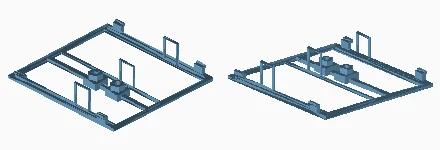

Quantity: 1. Material/color: matte_white_PLA. Size: 156.0 x 151.9 x 30.0 mm. Bed: 45.
[Print mesh](../../print/simplified/parts/A04_PORTANT_1_N2.stl)

### A04_PORTANT_1_N3

Quantity: 1. Material/color: matte_white_PLA. Size: 156.0 x 151.9 x 30.0 mm. Bed: 32.
[Print mesh](../../print/simplified/parts/A04_PORTANT_1_N3.stl)

### A04_PORTANT_1_N4
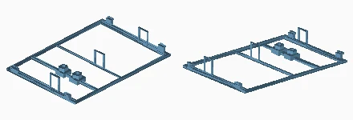

Quantity: 1. Material/color: matte_white_PLA. Size: 156.0 x 223.5 x 30.0 mm. Bed: 27.
[Print mesh](../../print/simplified/parts/A04_PORTANT_1_N4.stl)

### A04_PORTANT_2_N1
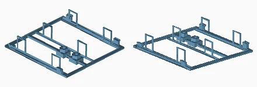

Quantity: 1. Material/color: matte_white_PLA. Size: 156.0 x 151.9 x 30.0 mm. Bed: 46.
[Print mesh](../../print/simplified/parts/A04_PORTANT_2_N1.stl)

### A04_PORTANT_2_N2
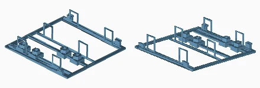

Quantity: 1. Material/color: matte_white_PLA. Size: 156.0 x 151.9 x 30.0 mm. Bed: 47.
[Print mesh](../../print/simplified/parts/A04_PORTANT_2_N2.stl)

### A04_PORTANT_2_N3

Quantity: 1. Material/color: matte_white_PLA. Size: 156.0 x 151.9 x 30.0 mm. Bed: 33.
[Print mesh](../../print/simplified/parts/A04_PORTANT_2_N3.stl)

### A04_PORTANT_2_N4
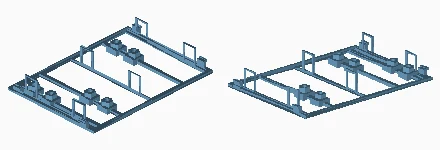

Quantity: 1. Material/color: matte_white_PLA. Size: 156.0 x 223.5 x 30.0 mm. Bed: 28.
[Print mesh](../../print/simplified/parts/A04_PORTANT_2_N4.stl)

### A04_PORTANT_3_N1
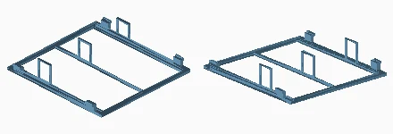

Quantity: 1. Material/color: matte_white_PLA. Size: 156.0 x 151.9 x 30.0 mm. Bed: 48.
[Print mesh](../../print/simplified/parts/A04_PORTANT_3_N1.stl)

### A04_PORTANT_3_N2

Quantity: 1. Material/color: matte_white_PLA. Size: 156.0 x 151.9 x 30.0 mm. Bed: 49.
[Print mesh](../../print/simplified/parts/A04_PORTANT_3_N2.stl)

### A04_PORTANT_3_N3
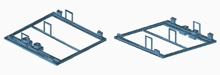

Quantity: 1. Material/color: matte_white_PLA. Size: 156.0 x 151.9 x 30.0 mm. Bed: 34.
[Print mesh](../../print/simplified/parts/A04_PORTANT_3_N3.stl)

### A04_PORTANT_3_N4
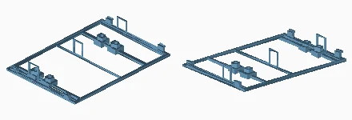

Quantity: 1. Material/color: matte_white_PLA. Size: 156.0 x 223.5 x 30.0 mm. Bed: 29.
[Print mesh](../../print/simplified/parts/A04_PORTANT_3_N4.stl)

### S01_SCARA_RAMPA_INFERIOARA
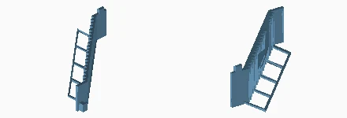

Quantity: 3. Material/color: orange_PLA. Size: 104.8 x 112.0 x 30.0 mm. Bed: 61, 62.
[Print mesh](../../print/simplified/parts/S01_SCARA_RAMPA_INFERIOARA.stl)

### S02_SCARA_RAMPA_SUPERIOARA
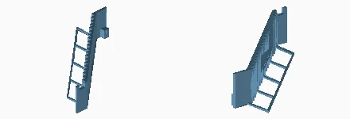

Quantity: 3. Material/color: orange_PLA. Size: 99.8 x 112.0 x 26.0 mm. Bed: 62, 63.
[Print mesh](../../print/simplified/parts/S02_SCARA_RAMPA_SUPERIOARA.stl)

### J03_PROBA_IMBINARI
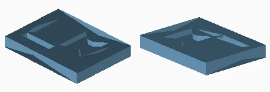

Quantity: 1. Material/color: matte_white_PLA. Size: 32.0 x 24.0 x 4.0 mm. Bed: 1.
[Print mesh](../../print/simplified/parts/J03_PROBA_IMBINARI.stl)

### B01_SOCLU_SPATE
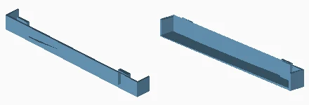

Quantity: 3. Material/color: anthracite_PLA. Size: 156.0 x 14.0 x 15.8 mm. Bed: 58, 59.
[Print mesh](../../print/simplified/parts/B01_SOCLU_SPATE.stl)

### B02_TALPA_FATA
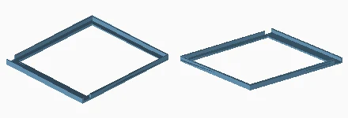

Quantity: 3. Material/color: anthracite_PLA. Size: 156.0 x 175.2 x 8.0 mm. Bed: 58, 59, 60.
[Print mesh](../../print/simplified/parts/B02_TALPA_FATA.stl)

### E02_CUTIE_SURSA_12V
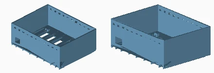

Quantity: 1. Material/color: matte_white_PLA. Size: 138.0 x 105.0 x 52.0 mm. Bed: 56.
[Print mesh](../../print/simplified/parts/E02_CUTIE_SURSA_12V.stl)

### E03_CAPAC_SURSA
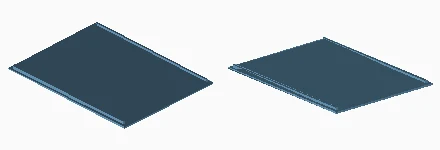

Quantity: 1. Material/color: matte_white_PLA. Size: 138.0 x 105.0 x 3.8 mm. Bed: 56.
[Print mesh](../../print/simplified/parts/E03_CAPAC_SURSA.stl)

### E04_BRIDA_SURSA
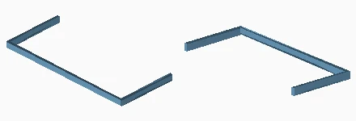

Quantity: 2. Material/color: orange_PLA. Size: 114.6 x 50.3 x 5.0 mm. Bed: 61.
[Print mesh](../../print/simplified/parts/E04_BRIDA_SURSA.stl)

### E05_CUTIE_COMANDA
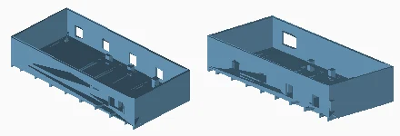

Quantity: 1. Material/color: matte_white_PLA. Size: 164.0 x 75.0 x 33.0 mm. Bed: 57.
[Print mesh](../../print/simplified/parts/E05_CUTIE_COMANDA.stl)

### E06_CAPAC_COMANDA
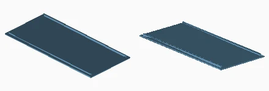

Quantity: 1. Material/color: matte_white_PLA. Size: 164.0 x 75.0 x 3.8 mm. Bed: 57.
[Print mesh](../../print/simplified/parts/E06_CAPAC_COMANDA.stl)

### E07_CANAL_ACOPERIS_1
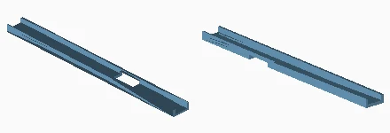

Quantity: 1. Material/color: matte_white_PLA. Size: 156.0 x 14.0 x 5.0 mm. Bed: 24.
[Print mesh](../../print/simplified/parts/E07_CANAL_ACOPERIS_1.stl)

### E07_CANAL_ACOPERIS_2
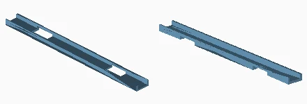

Quantity: 1. Material/color: matte_white_PLA. Size: 156.0 x 14.0 x 5.0 mm. Bed: 24.
[Print mesh](../../print/simplified/parts/E07_CANAL_ACOPERIS_2.stl)

### E07_CANAL_ACOPERIS_3
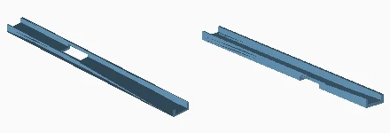

Quantity: 1. Material/color: matte_white_PLA. Size: 156.0 x 14.0 x 5.0 mm. Bed: 24.
[Print mesh](../../print/simplified/parts/E07_CANAL_ACOPERIS_3.stl)

### E08_CAPAC_CANAL_ACOPERIS
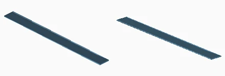

Quantity: 3. Material/color: matte_white_PLA. Size: 156.0 x 14.0 x 0.6 mm. Bed: 25.
[Print mesh](../../print/simplified/parts/E08_CAPAC_CANAL_ACOPERIS.stl)

### T02_TRAPA_ACOPERIS
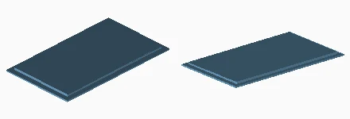

Quantity: 1. Material/color: matte_white_PLA. Size: 66.0 x 112.0 x 2.8 mm. Bed: 32.
[Print mesh](../../print/simplified/parts/T02_TRAPA_ACOPERIS.stl)

### B03_SOCLU_SPATE_CU_TALPA

Quantity: 3. Material/color: anthracite_PLA. Size: 156.0 x 14.0 x 17.4 mm. Bed: 59, 60.
[Print mesh](../../print/simplified/parts/B03_SOCLU_SPATE_CU_TALPA.stl)

