# Stand reinforcement

The two views are rendered from the linked print file at independent scale. See the dimensions to distinguish similar parts.

### R01_RIGHT_RIB
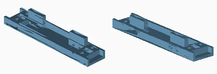

Quantity: 4. Material/color: anthracite. Size: 169.6 x 35.5 x 24.3 mm.
[Print mesh](../../print/03_reinforcement/anthracite/R01_RIGHT_RIB__qty_04.stl)

### R02_LEFT_RIB
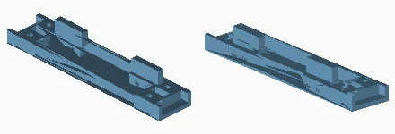

Quantity: 4. Material/color: anthracite. Size: 169.6 x 35.5 x 24.3 mm.
[Print mesh](../../print/03_reinforcement/anthracite/R02_LEFT_RIB__qty_04.stl)

### R03_FRONT_CLAMP
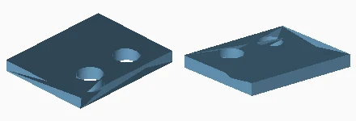

Quantity: 16. Material/color: white. Size: 24.3 x 30.0 x 3.0 mm.
[Print mesh](../../print/03_reinforcement/white/R03_FRONT_CLAMP__qty_16.stl)

### R04_SIDE_SPLICE
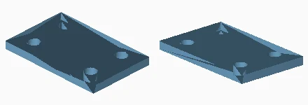

Quantity: 6. Material/color: white. Size: 56.0 x 35.5 x 4.0 mm.
[Print mesh](../../print/03_reinforcement/white/R04_SIDE_SPLICE__qty_06.stl)

### R05_SHORT_SCREW_15MM
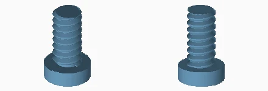

Quantity: 34. Material/color: white. Size: 9.4 x 9.4 x 15.0 mm.
[Print mesh](../../print/03_reinforcement/white/R05_SHORT_SCREW_15MM__qty_34.stl)

### R21_LONG_SCREW_18_8MM
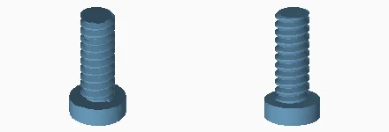

Quantity: 26. Material/color: white. Size: 9.4 x 9.4 x 18.8 mm.
[Print mesh](../../print/03_reinforcement/white/R21_LONG_SCREW_18_8MM__qty_26.stl)

### R22_LEFT_CENTRE_BASE_SUPPORT
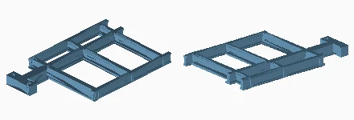

Quantity: 2. Material/color: anthracite. Size: 156.0 x 246.0 x 18.0 mm.
[Print mesh](../../print/03_reinforcement/anthracite/R22_LEFT_CENTRE_BASE_SUPPORT__qty_02.stl)

### R23_RIGHT_REAR_BASE_SUPPORT
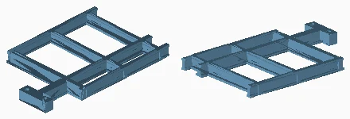

Quantity: 2. Material/color: anthracite. Size: 156.0 x 246.0 x 18.0 mm.
[Print mesh](../../print/03_reinforcement/anthracite/R23_RIGHT_REAR_BASE_SUPPORT__qty_02.stl)

### R24_FOOT_RETAINING_SADDLE
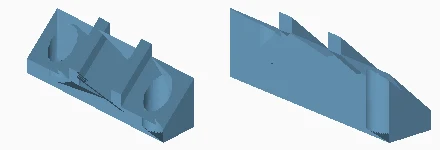

Quantity: 4. Material/color: orange. Size: 54.0 x 12.0 x 19.9 mm.
[Print mesh](../../print/03_reinforcement/orange/R24_FOOT_RETAINING_SADDLE__qty_04.stl)

### R25_FOOT_SCREW_61MM
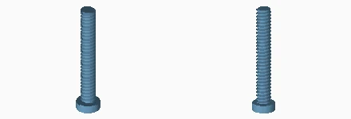

Quantity: 8. Material/color: white. Size: 12.5 x 12.5 x 61.0 mm.
[Print mesh](../../print/03_reinforcement/white/R25_FOOT_SCREW_61MM__qty_08.stl)

### R26_ASSEMBLY_KEY
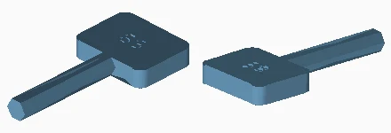

Quantity: 1. Material/color: white. Size: 24.0 x 50.7 x 5.2 mm.
[Print mesh](../../print/03_reinforcement/white/R26_ASSEMBLY_KEY__qty_01.stl)

### R31_REAR_FOOT_ADAPTER
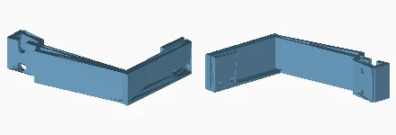

Quantity: 1. Material/color: anthracite. Size: 164.7 x 148.6 x 44.0 mm.
[Print mesh](../../print/03_reinforcement/anthracite/R31_REAR_FOOT_ADAPTER__qty_01.stl)

### R41_CLIP_ON_CABLE_GUIDE
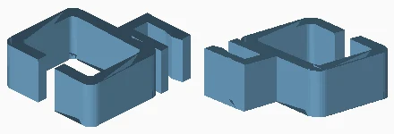

Quantity: 4. Material/color: anthracite. Size: 20.0 x 22.8 x 8.0 mm.
[Print mesh](../../print/03_reinforcement/anthracite/R41_CLIP_ON_CABLE_GUIDE__qty_04.stl)

### F18_EXTRA_REAR_FOOT
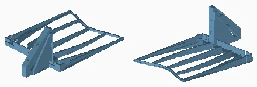

Quantity: 1. Material/color: anthracite. Size: 156.0 x 246.0 x 86.0 mm.
[Print mesh](../../print/03_reinforcement/anthracite/F18_EXTRA_REAR_FOOT__qty_01.stl)

