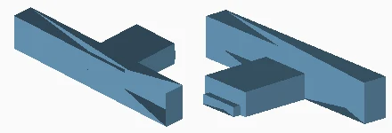
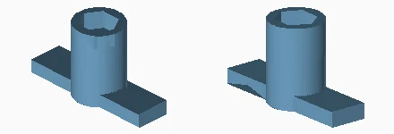

# Workshop tools and additional exports

The two views are rendered from the linked print file at independent scale. See the dimensions to distinguish similar parts.

### AXLE_HEAD_FLAT_KEY__qty_01

Quantity: see file. Material/color: 08_shared_tools. Size: 28.0 x 13.0 x 5.0 mm.
[Print mesh](../../print/08_shared_tools/AXLE_HEAD_FLAT_KEY__qty_01.stl)

### SIDE_CONE_SOCKET_KEY__qty_01

Quantity: see file. Material/color: 08_shared_tools. Size: 40.0 x 14.6 x 22.0 mm.
[Print mesh](../../print/08_shared_tools/SIDE_CONE_SOCKET_KEY__qty_01.stl)

