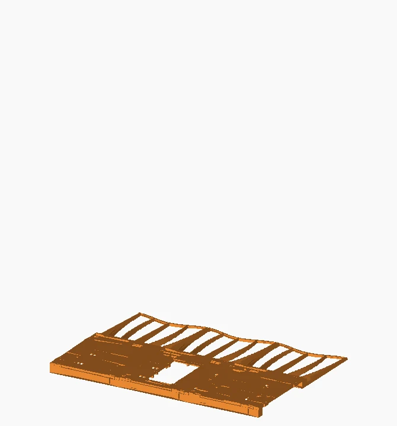
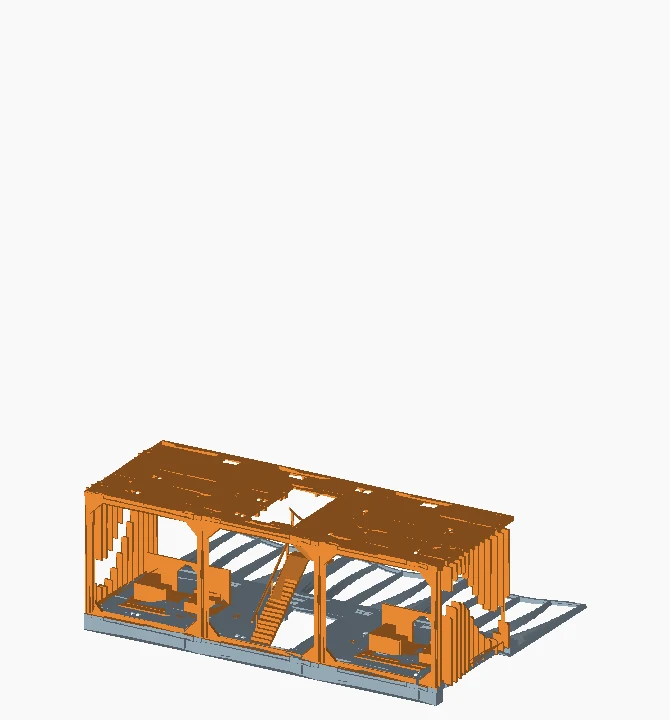
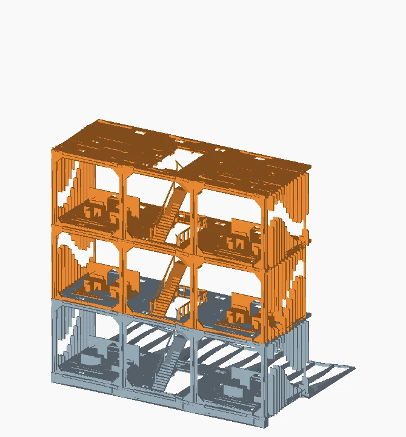
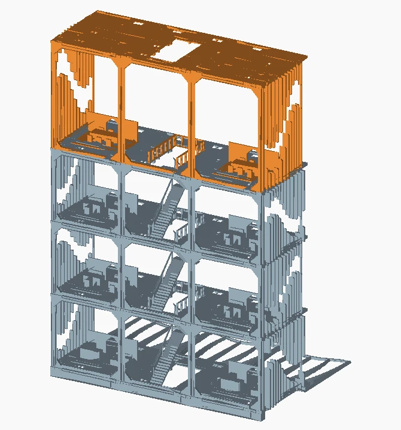
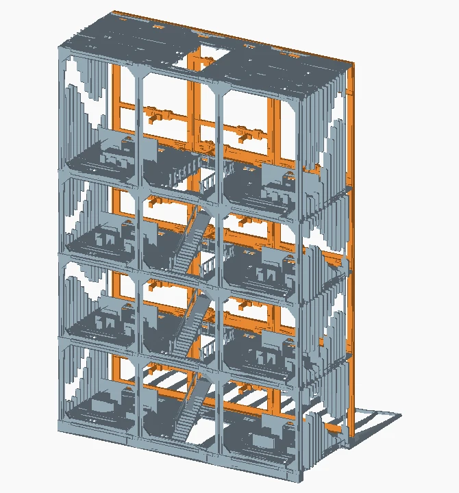
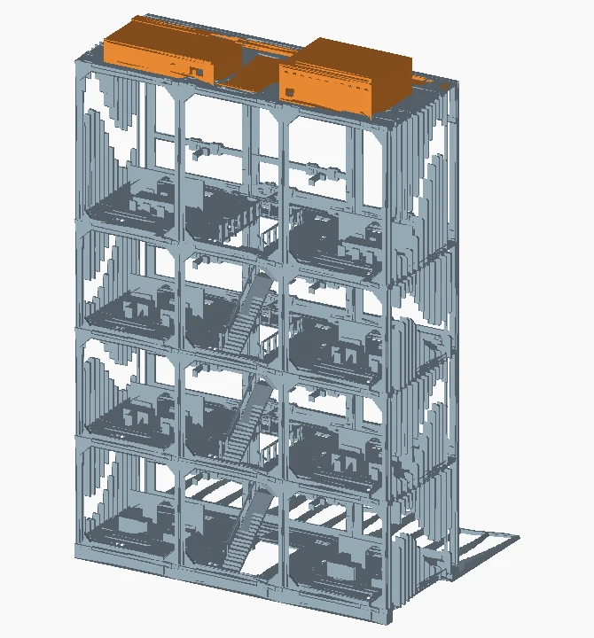

# Furnished office - assembly sequence

Orange identifies the group being discussed. Blue-grey gives the installed context. Views show final part positions. Fit each storey while it is open.

## 1. Base and first floor

J03 fit coupon; A01 bays 1, 2 and 3; J01 floor keys; three B03 rear bases and three B04 fan bases.

Test the printed joint with J03. Lay out the three floor bays in their CAD order. The central stair opening sets the orientation of the middle bay. Seat the floor on the base and install its mating keys.

**Check before continuing.** Use a flat surface. A stepped seam or a floor that rocks prevents the next level from seating.

## 2. First occupied level

A02 rear frames, S01 lower stair flight and S02 upper flight.

Locate the rear frames in the floor sockets. Assemble the two stair flights in the central opening. Build the sides and first interior while the space above the floor remains accessible. Fit the two I01 reception units at N1 and locate each with an I02 two-pin bar from above. Fit the A05/A06 side panels by their matching CAD positions.

**Check before continuing.** Look down through the opening. The landing must meet the next floor and the stair must clear the adjacent room.

## 3. Intermediate floors

A01 bays at each level; ordinary rear and side frames; stair flights.

Repeat the three-bay floor stack. The CAD floor origins rise from 18.0 to 170.1, 322.2 and 474.3 mm. Assemble each occupied storey before covering it. Place the four workshop units across N2 and N3. Install the stair guards I03 and separate S03 rails while accessible.

**Check before continuing.** Use the three equal 152.1 mm level intervals to identify ordinary storeys. They are assembly-origin differences, not dimensions to add to individual STL parts.

## 4. Upper storey and roof

Tall rear and side elements; A01 roof bays; T02 roof hatch.

Use the tall frame parts at N4. The last floor-to-roof interval is 223.7 mm. Keep the service opening accessible when placing the three roof bays and the hatch. Fit both meeting-area units at N4 and use the tall A07 fin panels.

**Check before continuing.** Check the roof origin at Z = 698.0 mm in the scene. The hatch must remain accessible after fitting the cable channels.

## 5. Front structure and receivers

Twelve F04 cassettes; six F05, two F06 and nine F07 splice keys; 32 F01 bolts and 16 F02 locking bars.

Build three facade columns across four levels on a flat surface. Keep the module positions in front-view order: M01 to M04 at the top, M13 to M16 at the bottom. Columns 2 and 4 are rotated 180 degrees in the saved layouts. Match each C1-C3 and N1-N4 cassette. Join the vertical edges with F05/F06 and horizontal edges with F07 as shown in the scene. Each receiver takes two bolts and one locking bar.

**Check before continuing.** Test one receiver and check tool access from behind it. Support the module body while fitting it. Repeat only after the first mount allows the required leaf travel.

## 6. Roof equipment and cabling

E02 enclosure, E03 lid, two E04 clamps, E05/E06 control enclosure, E07 channels and E08 covers.

Check the actual boards and source against the mounting geometry. Place the housings before routing cables. Route low-voltage leads to the drivers, leave service loops and fit the channel covers last.

**Check before continuing.** With motor power off, move the leaves through their travel and remove one service cover. The cable should neither pull on its connector nor enter the linkage sweep.

