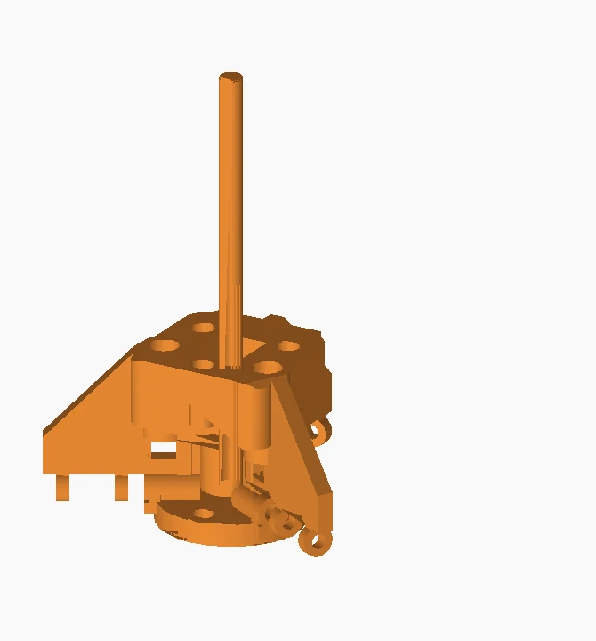
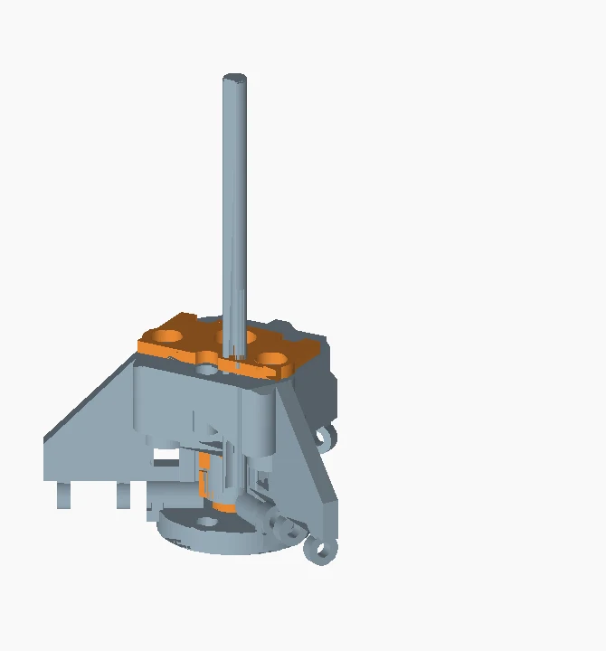
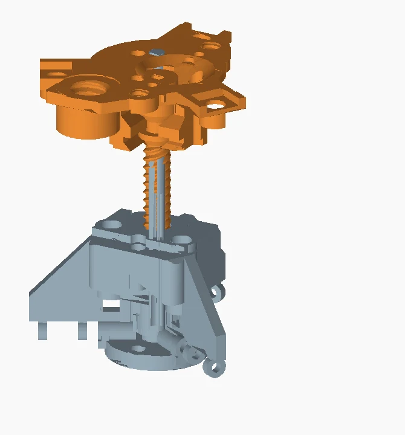
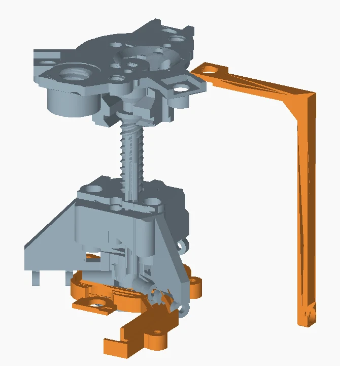
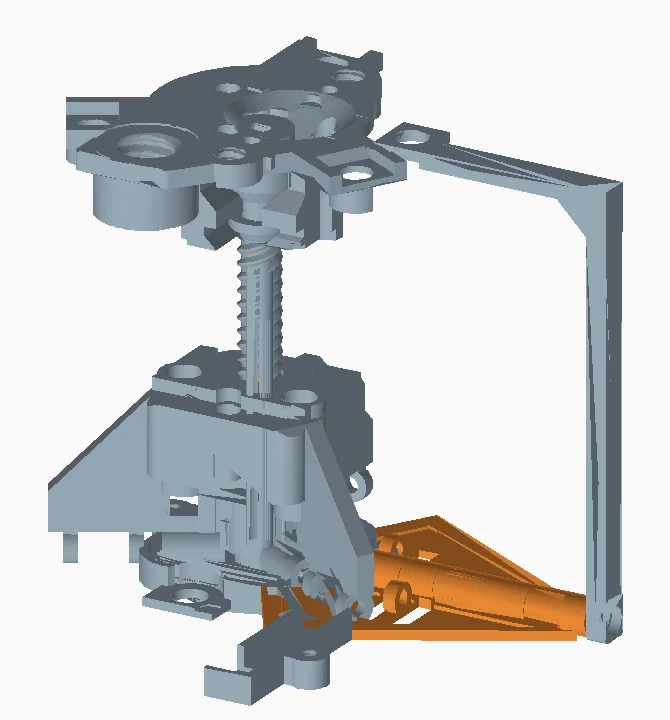
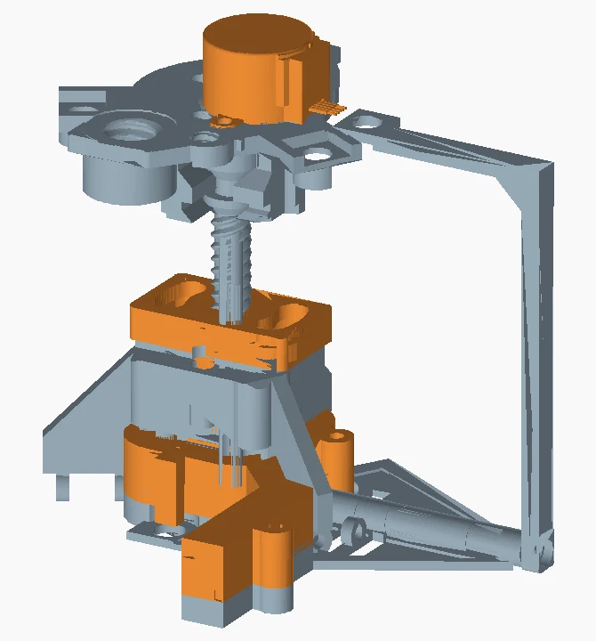

# One kinetic module - assembly sequence

Orange identifies the group being discussed. Blue-grey gives the installed context. Views show final part positions. Fit each storey while it is open.

## 1. Guides and carriage

P04, three P09 guides, P10.

Fit the three D-profile guides in the matching hub sockets. Slide the carriage onto all three together. The flat faces locate the carriage angularly.

**Check before continuing.** Run the bare carriage along the guides by hand. Correct a burr or a misaligned guide before adding the screw.

## 2. Matched nuts and cover

P12, P26, P11 and two P29 screws.

Test both nuts on P13. Place them in their lower and upper carriage pockets. Seat P11 and tighten the two cover screws alternately. Excess clamping pressure can bind the nut pair.

**Check before continuing.** Rotate the screw through the assembled nuts by hand. Both nuts must follow the same three-start, 10 mm-lead profile.

## 3. Insert the lead screw

P02 and P13.

With the motor off the rear frame, bring P13 through the lateral opening. Keep the shaft parallel to its final axis, then seat its shoulder at the bearing. Lower this pair onto the guides and turn the screw into the nuts.

**Check before continuing.** Observe the carriage while turning P13. One turn advances it 10 mm where enough free stroke remains. Keep the carriage aligned on the guides.

## 4. Pillars, bushings and driver tray

Three P05; two P33/P34 pairs; P36/P37; E01.

Fit the two short bushing and cone pairs to the ordinary pillar sectors. At the tray, use the longer P36 bushing from below and P37 cone from above. Install the tray before closing the driver enclosure.

**Check before continuing.** Compare the two short stacks with the longer tray stack. All three pillars should seat without bowing the guides.

## 5. Leaves, axles and link rods

Three left and three right P07 leaves; three P08 axles; six P16 rods; twelve P32 nuts.

Pair one left and one right leaf at each sector. Insert P08 from the outside and engage its terminal thread in the hub. Attach each rod between a leaf and the carriage. Retain each end with a P32 nut.

**Check before continuing.** Move all six joints by hand. The rod must pivot at both ends. A tight nut that clamps the joint will make the motor lose steps.

## 6. Drive, wiring and receiver

Two P30/P03/P31 stacks; E02 and three E03; P44, P45 and P46.

Align the geared motor output with P13, then fit the clamps. Seat the driver, route the cable and close E02. Thread P44 into the rear frame, slide on the D-profile P45 receiver, and insert the transverse P46.

**Check before continuing.** Support the module by the body. Check the rod sweep, cable clearance and receiver alignment before attaching it to its chosen support.

