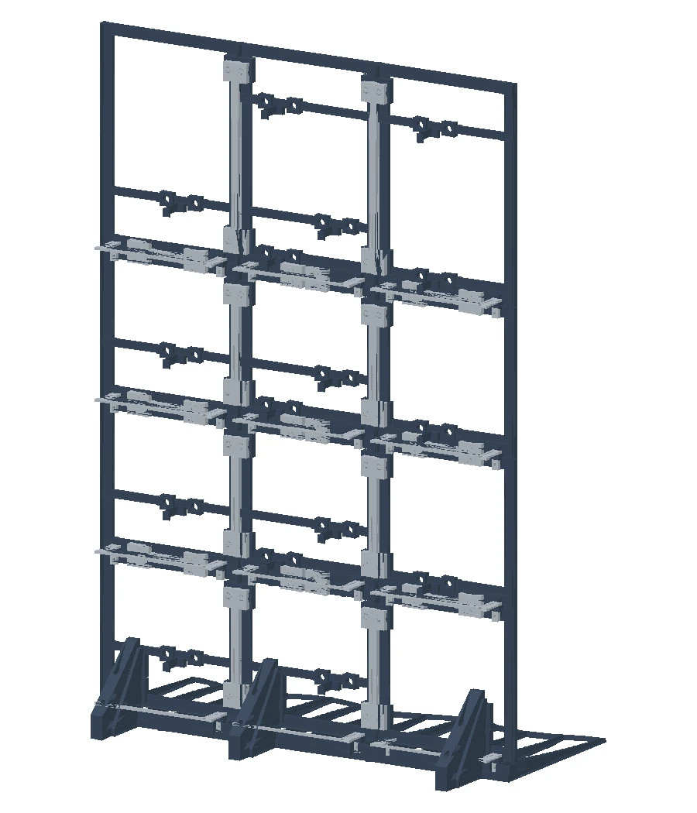
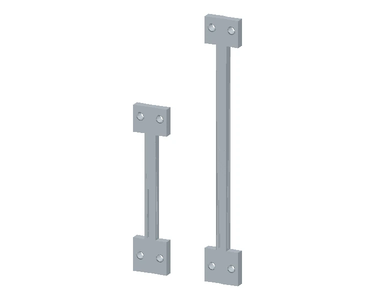
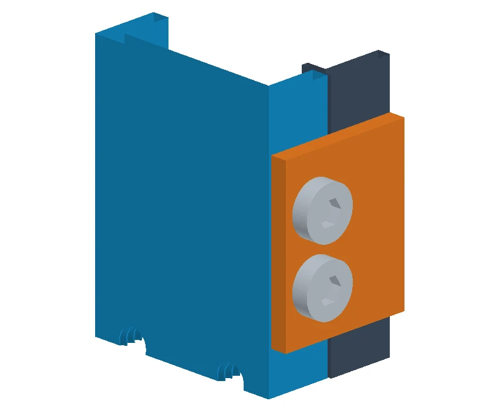
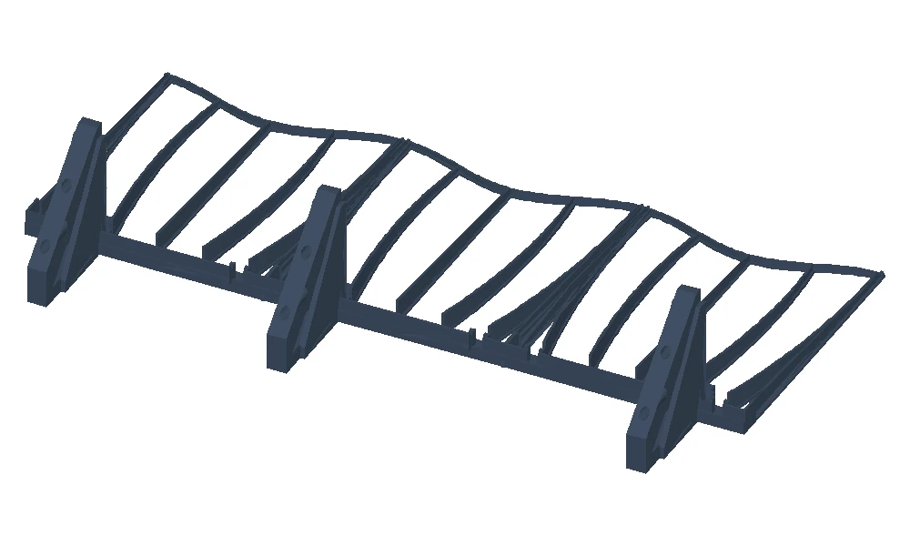
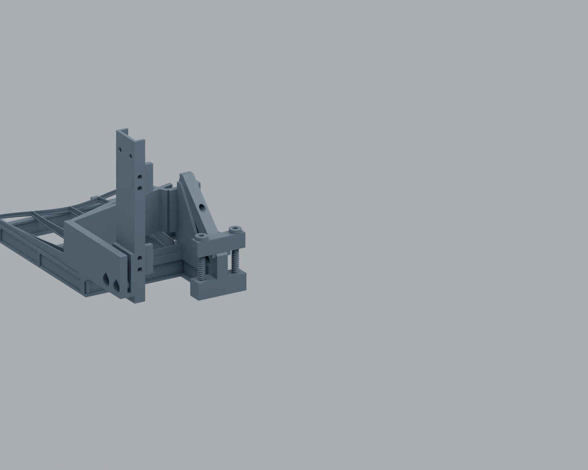
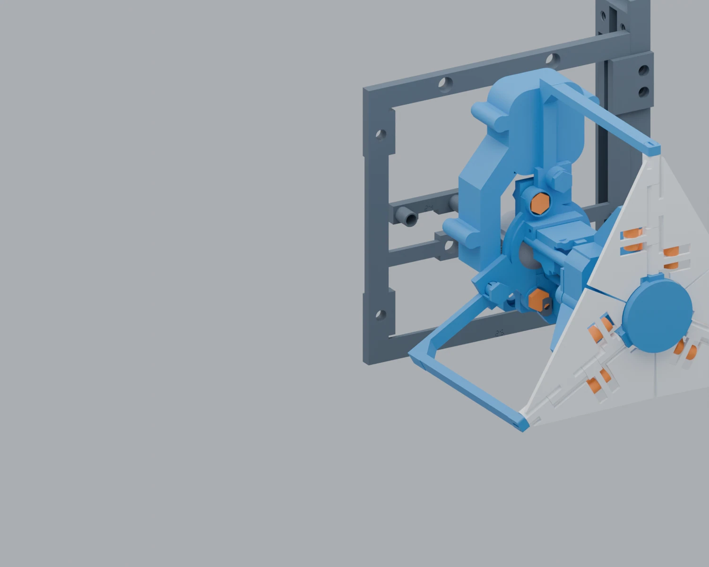

# Independent reinforced stand - assembly sequence

Use the rear-view cassette map first. The CAD illustrations use different viewing directions; keep the engraved IDs visible when working.

## 1. Lay out the cassettes

Twelve F04 cassettes, engraved 25 to 36.

View the frame from the rear. Arrange the top row as 28, 32, 36. Continue down with 27, 31, 35 then 26, 30, 34. Finish with 25, 29, 33 at the base. Align the cassette seams on a flat surface before installing the matching splices.

**Check before continuing.** Check each engraved ID. The twelve cassettes together support sixteen module receivers.

## 2. Join the side ribs

Four R01, four R02, six R04 plates and 24 R21 splice bolts.

Use the four right ribs on the right and the four left ribs on the left. Position the six splice plates across the rib joints, four R21 bolts to a plate. Start all four before tightening the plate.

**Check before continuing.** The rib joints should seat evenly. Reserve the other two R21 bolts for the rear adapter.

## 3. Attach the front clamps

Sixteen R03 clamps and 32 R05 bolts.

Fit the clamps at the frame-to-rib interfaces shown in scene 03. Use two R05 bolts for each clamp. Support the frame while aligning the ribs.

**Check before continuing.** Check access to every receiver and look along the frame for twist. Reserve two R05 bolts for the rear foot.

## 4. Stiffen the feet

Two R22 supports, two R23 supports, four R24 saddles and eight R25 screws.

R22 fits the original left and middle F13 feet. R23 fits the original right F18 and the extra rear F18. Secure each sole with one saddle and two long R25 screws.

**Check before continuing.** Place all four supported feet on the table. The nominal raise is 18 mm. Check seating before final tightening.

## 5. Fit the rear adapter

R31, extra F18 foot, two R05 and two R21.

Rotate the extra foot in plan so that it extends behind the stand. Place R31 against its upright. The two R05 screws engage the foot at nominal heights of 34 and 60 mm. Use two R21 screws to attach the adapter to the lower right rib.

**Check before continuing.** Check that the rear sole extends the support footprint and that the original feet remain seated.

## 6. Mount the mechanisms

Two F01 bolts and one F02 bar per occupied receiver; F17 long key.

Work from the bottom up, alternating sides. Place F02 behind the cassette with its bushings toward P45. Start both flattened-head F01 bolts from the front. Align the heads with their recesses and tighten alternately. Fit an R41 cable clip where needed and leave a free cable loop.

**Check before continuing.** With the motors unpowered, turn each mechanism through its free range. Check adjacent leaves, bolt heads, loose cables and the stance of the loaded frame.

